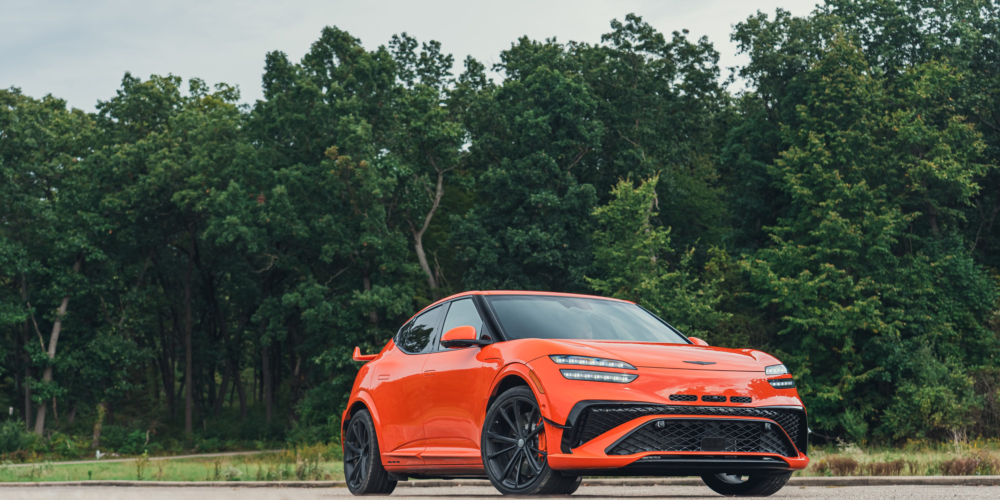

## The Story

This electric performance model makes 641 horsepower and features a dedicated drift mode for tire-smoking shenanigans.

Marc Urbano|Car and DriverMSRP$47,795–$72,145Shop NewShop UsedGet your trade-in valueHIGHSBattery charges quickly on DC connection, agile handling, whimsical faux engine sounds.LOWSSmaller inside than some rivals, Magma offers limited driving range, small front trunk.VERDICTThe GV60 is a Hyundai Ioniq 5 that went to finishing school, while the GV60 Magma is an Ioniq that went to racing school.For Sale Near YouSee all results for new 2027 Genesis GV60 for sale near 83.

Genesis’s smallest SUV is the electric GV60, which is offered in a variety of flavors from the tame rear-wheel drive base model to the wild, 641-hp Magma performance trim. While the standard model is set up primarily for comfort, the GV60 Magma adds plenty of aggression to the formula.

Driving range for the base rear-wheel-drive model is highest in the bunch at 306 miles per charge. Going with all-wheel drive or the Magma trim reduces driving range dramatically, but all models offer quick charging times thanks to a robust 800-volt architecture.

Expert Tip: Genesis makes it clear that the ultimate goal of the GV60 Magma is to offer a sophisticated take on performance, melded with plenty of luxury rather than rip-your-guts-out performance; if EV ferocity is your sole desire, check out the Ioniq 5 N.

Compare the 2027 Genesis GV60 with the top vehicles in this segment with our new compare tool. The GV60 Magma is a new variant this year, spearheading the GV60’s push into the performance EV class. It replaces last year’s Performance trim. 2027 also sees the introduction of an all-wheel-drive Prestige trim that bridges the gap between the base GV60 model and the new Magma.

The rear-wheel-drive GV60 Standard gets motivation from a single rear-mounted 225-hp motor; going with all-wheel drive adds a front motor for a combined 314 horsepower. The GV60 Magma boosts output to 641 ponies.

The GV60's road manners are quite refined. When cruising, the cabin remains whisper quiet; encounter a stretch of winding road, though, and the GV60 offers enough athleticism to entertain the driver and enough surefootedness to inspire confidence. The chassis has been recalibrated for the Magma with specific damper and power distribution metrics, along with chunky 275/35R-21 tires specially developed for the Magma by Pirelli.

In addition to Launch Control and Boost mode, drivers have a choice of three additional drive modes: Sprint, GT, and MY, the latter allowing for customization of the electronically controlled limited-slip differential, stability control, and other performance factors. There's also a drift mode, but Genesis is careful not to call it a &quot;drive&quot; mode for normal street use. When we drove the GV60 Magma, we found it to be nimble in the corners and more polished than the Ioniq 5 N.

In Comparison: The Ioniq 5 N, with an identical 641 horsepower in Boost mode, also ripped to 60 mph in 3.0 seconds in our testing. Although most buyers likely won't hook a trailer up to the GV60, it can tow up to 2000 pounds.

The GV60 uses a lithium-ion battery with 84 kW of usable capacity. The rear-wheel-drive base model offers the most range at 306 miles per charge, while the Magma trim offers the least at 220 miles. In our real-world 75-mph highway range test, the Magma went just 200 miles. DC fast charging is available, with Genesis claiming the GV60 can be replenished from 10-to-80 percent in just 18 minutes. C/D testing corroborates this claim, as our test vehicle replenished the battery from 13 percent to 80 percent in 18 minutes. Genesis says a level 2 AC charger can replenish the battery from 10 to 100 percent in about seven hours.

The EPA estimates that the rear-wheel drive GV60 should deliver up to 119 MPGe city, 101 MPGe highway, and 110 MPGe combined. All-wheel-drive models are rated for up to 107 MPGe city, 93 MPGe highway, and 100 MPGe combined. The Magma is rated for 84 MPGe city, 72 MPGe highway, and 78 MPGe combined. MPGe stands for miles per gallon of gas equivalent, an EPA metric that estimates PHEV and EV fuel efficiency. For more information about the GV60's fuel economy, visit the EPA's website.

## Why It Matters

First Row: Though the Genesis GV60 isn't as spacious as its larger GV70 and GV80 siblings, it offers a slightly more modern interior that embraces the high-tech concept.

<figure class="article-inline-img">
  
  <figcaption class="img-credit">Source: caranddriver.com (original article)</figcaption>
</figure>

## CarMotion Daily's Take

Second Row: Rear seat space and comfort are expected to be the same as the non-Magma GV60, but we wouldn’t rule out more aggressive bolstering that might make fitting three across difficult or impossible. Watch this space over the coming weeks. Supply chains, regulations, and consumer demand are reshaping the playbook faster than five-year plans can keep up. Dealer networks and service capacity will need to evolve alongside whatever the headline announcement implies. Regulatory filings, supplier contracts, and any production-volume adjustments usually trail the headline by a quarter or two. Stock price moves and dealer council chatter are leading indicators worth monitoring.

---

📝 Source & Copyright Notice

  <strong>Original Source:</strong> 
  This story was first reported by <strong>CarAndDriver</strong>.
  For the full article with original photography and complete coverage, visit the source:
  <a href="https://www.caranddriver.com/genesis/gv60" target="_blank" rel="noopener">Read the full story at CarAndDriver →</a>

  ⚠️ <strong>Copyright Notice:</strong> CarMotion Daily is an automated news aggregation service.
  We publish short rewritten summaries under Fair Use principles, with links back to the original sources.
  Images are extracted directly from the original news articles via Open Graph protocol, with attribution.
  All trademarks and copyrights belong to their respective owners. For takedown requests, contact us.

