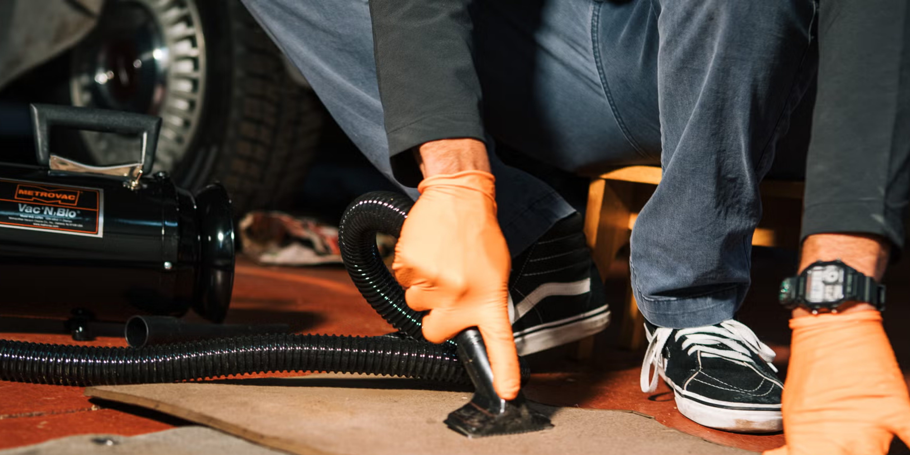

## The Story

We put the top car vacuums to the test on a dusty-but-beloved Porsche Boxster. Here’s what sucked (in a good way).

Our car experts choose every product we feature. We may earn money from the links on this page. ✍️ Editor’s note: We will update this article in the coming months to reflect new products and feature updates.This article was updated in November 2026.

A clean car is a happy car, but you need the right vacuum to keep things tidy. (As an outdoor adventurer and proud pet owner, I know this all too well.) So, do I really need a special vacuum just for my car?. Yes. That’s why I was excited to put a fleet of top-rated car vacuums to the test on a dusty Porsche Boxster at our garage in New Jersey. After deciding which units we wanted to focus on, we assessed suction power, ease of use, hose length, portability, attachment versatility, and overall quality. A good vacuum should make detailing effortless, not frustrating.

Whether you just want to tidy up or are a serious detailer, these are the car vacuums that stood out in our hands-on testing. Each proved they can handle everything from fine road dirt to the stubborn fur of a rambunctious dog. If it made our list, it’s because we’d use it ourselves.

More Car-Care Gear: Best Leather Car Cleaners | Best Upholstery Cleaners | Best Interior Cleaners. The Metrovac Vac N Blo isn’t just a car vacuum. This machine is a steel-bodied detailer with a 4-hp motor that delivers serious suction and blower power. The two flexible six-foot hoses aren’t flimsy plastic cords; they’re made with a pro-grade material for those who take cleaning seriously.

When you need to dry your car or blast grit out of vents, the blower function is just as powerful, making it a true two-in-one garage essential. I used this setting to blow the bits of dirt and gravel right out of the garage door.

It also allows you the option to attach wheels, making it even easier to maneuver. In this case, I attached the shoulder strap and had it move with me as I worked my way around the mats and car. It’s also a very sleek design—it looked sharp in the garage and stood out not just in performance but also in aesthetics.

Beyond its power, the all-metal construction gives it a level of durability you won’t find in typical car vacuums. The long hose and multiple attachments make tackling every inch of your interior easy, turning a once-dreaded task into a precision operation. If you want a vacuum that’ll deliver professional-level results, the Metrovac Vac N Blo is the one to get.

## Why It Matters

Drilling holes in our space to mount several vacuums was not an option, but we did our best to re-create this real-world scenario.

<figure class="article-inline-img">
  
  <figcaption class="img-credit">Source: roadandtrack.com (original article)</figcaption>
</figure>

## CarMotion Daily's Take

Understanding these features will help you find a vacuum that best suits your needs, whether you prioritize strong suction for deep cleaning, versatile tools for detail work, or the malleability of a hose. Watch this space over the coming weeks. Supply chains, regulations, and consumer demand are reshaping the playbook faster than five-year plans can keep up. Dealer networks and service capacity will need to evolve alongside whatever the headline announcement implies. Regulatory filings, supplier contracts, and any production-volume adjustments usually trail the headline by a quarter or two. Stock price moves and dealer council chatter are leading indicators worth monitoring.

---

📝 Source & Copyright Notice

  <strong>Original Source:</strong> 
  This story was first reported by <strong>RoadandTrack</strong>.
  For the full article with original photography and complete coverage, visit the source:
  <a href="https://www.roadandtrack.com/gear/g64308010/best-car-vacuums/" target="_blank" rel="noopener">Read the full story at RoadandTrack →</a>

  ⚠️ <strong>Copyright Notice:</strong> CarMotion Daily is an automated news aggregation service.
  We publish short rewritten summaries under Fair Use principles, with links back to the original sources.
  Images are extracted directly from the original news articles via Open Graph protocol, with attribution.
  All trademarks and copyrights belong to their respective owners. For takedown requests, contact us.

