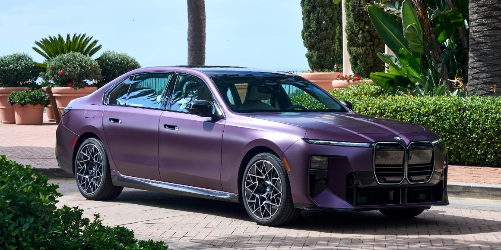

## The Story

Revised design and an updated interior sharpen the case for BMW’s biggest executive sedan.

BMWJump to:How Does It Drive?What Is It Like to Live With?Should I Buy One?Highlights and LowlightsBMW’s 7-series has been in a race with the Mercedes-Benz S-class for nearly 50 years over the German executive sedan crown. But an avant-garde, new-generation reimagining in 2022 knocked the long-wheelbase sedan off its pedestal. Four years later, BMW has tweaked the 7-series’s front and rear design and upgraded the interior with better technology. Also, it’s lost the “i” from the end of its badge, as part of BMW’s new policy on model naming. Can a shorter name, a prettier face, and new screens push it back into contention?.

In the hills above Lake Elsinore, the 740 xDrive showed off just how magically BMW’s adaptive chassis control system is, especially in its more able Professional guise. This uses full air suspension and active roll stabilization through an electrical system that applies torque against the sway bars to counter lean under cornering loads. So equipped, the 7-series rewarded a spirited pace on California canyon roads, despite a 4800-pound curb weight sitting atop a 126.6-inch wheelbase.

BMW is proud of its hands-free Highway Assistant semiautonomous driving system, and so I put this to the test on I-5 South. The SAE Level 2 system can drive hands-free up to 85 mph as long as you keep a forward gaze, and it did so well. From slowing for construction zones to autonomous lane changes, the semiautonomous system handled busy California traffic smartly and smoothly.

With a mild facelift and the same powertrains as before, the 2027 7-series’s most noticeable upgrades are all inside. BMW uses many buzzwords and acronyms to describe the new interior experience, but the most important one is the Panoramic iDrive system. As in the X5, iX3, i3, and new 3-series, the Neue Klasse direction has removed the old physical iDrive controller and replaced it with a fully touchscreen system. The 7-series now has a 17.9-inch central screen, a recessed 14.6-inch passenger display, and the long panoramic gauge cluster that sits atop the dashboard.

In practice, the new user experience was a mixed bag. I’m quick to criticize any vehicle that lacks tactile controls, and the glamour of BMW’s new system doesn’t belie this fault. Save for a scrolling volume control near the nub shifter, everything from climate control to vehicle settings must be manipulated through the central touchscreen. The screen responds quickly and has a permanent menu with obvious icons for climate control, vehicle settings, navigation, and media inputs. However, tapping on any of these icons once is only the start of a multistep process, much of which will be done with eyes off the road.

## Why It Matters

Four years later, BMW has tweaked the 7-series’s front and rear design and upgraded the interior with better technology.

<figure class="article-inline-img">
  
  <figcaption class="img-credit">Source: roadandtrack.com (original article)</figcaption>
</figure>

## CarMotion Daily's Take

Markets rarely reward single announcements — execution over the next two to four quarters is what closes the gap between press release and customer. How this lands depends less on the announcement itself and more on the rollout, dealer support, and after-sales story behind it. Specifics on pricing, availability, and regional rollout will tell us whether this moves from headline to delivery. Independent verification and follow-up coverage from rival outlets tend to firm up the picture within days.

---

📝 Source & Copyright Notice

  <strong>Original Source:</strong> 
  This story was first reported by <strong>RoadandTrack</strong>.
  For the full article with original photography and complete coverage, visit the source:
  <a href="https://www.roadandtrack.com/reviews/a74312218/2027-bmw-740-xdrive-drive-review/" target="_blank" rel="noopener">Read the full story at RoadandTrack →</a>

  ⚠️ <strong>Copyright Notice:</strong> CarMotion Daily is an automated news aggregation service.
  We publish short rewritten summaries under Fair Use principles, with links back to the original sources.
  Images are extracted directly from the original news articles via Open Graph protocol, with attribution.
  All trademarks and copyrights belong to their respective owners. For takedown requests, contact us.

