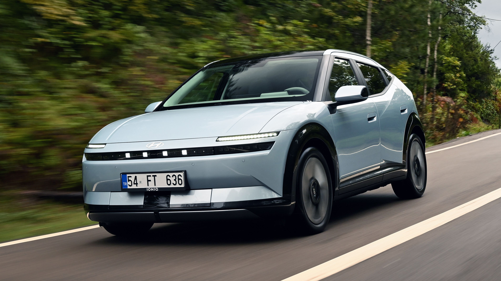
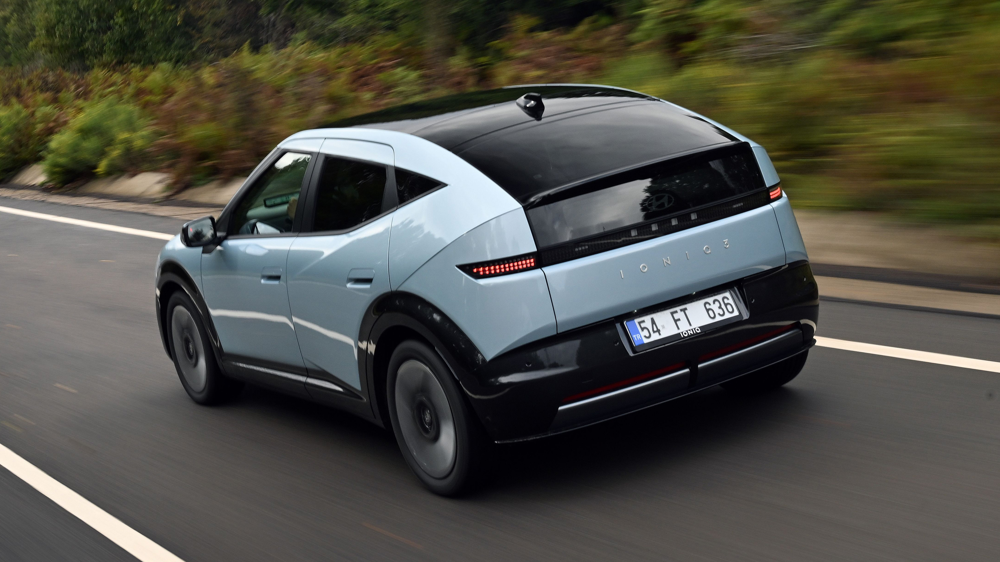

## The Story

Hyundai’s best Ioniq yet. A nicely finished, well rounded electric supermini at a price that will make rivals wince.

Bad stuffIt’s dark in the back… very dark, central screen is too busy, sportiest N Line version is weirdly the slowest. A small electric Hyundai. Junior to the Ioniq 5, big brother to the Inster and owner, as we’ve come to expect from Hyundai, of some suitably striking bodywork. That also happens to remind us of an 80s Honda CRX. Hyundai calls it an Aero Hatch, the rest of us would point out it’s got the same roofline as a coupe SUV, likely with the same resulting impact on practicality.

Happily no. It’s probably got one of the biggest boots in its class, but we’ll talk about that more fully later. What we’d like to bring your attention to right now are the basics. It’s a single motor, front drive, supermini-sized electric car, designed to do battle with everything else that’s compact enough to call town home, yet big enough to cope outside. Think Renault 5 and Cupra Raval up to Volvo EX30.

There’s a choice of two battery sizes, 42kWh or 61kWh (largely pointless since Hyundai says 95 per cent of Brit buyers have the big one, despite it being £3,500 more), with the smaller battery enjoying a slight power advantage (145bhp plays 134). Unusual. And because it’s that bit lighter, the base model is a better sprinter (8.8 seconds to 62mph vs 9.5) and leaves us in the odd position where the sportiest, top spec N Line version is actually the slowest car in the range (more kit and aero drag adding a further tenth).

Profit margins are better on bigger, more expensive cars, hence why early EVs were all big SUVs, then we had mid-size stuff – the Ioniq 5 first appeared back in 2021 – and once the economies of scale had been, er, scaled and the profit margins marginalised, we started seeing supermini EVs from the big players.

Underneath this shares a lot with the Kia EV2 that appeared a few months back and – oddly – is notably more expensive than the Ioniq 3. Because this car’s trump card is value for money. Prices run from £22,245 to £31,945.

Skip 5 photos in the image carousel and continue readingTurn on Javascript to see all the available pictures.1 / 5. Ah, but that’s before the Electric Car Grant is applied. This is now applied at two levels depending not only on how clean and green your car is, but how clean and green your factory and entire production process is. Band Two gives you a £1,500 discount, Band One gets you £3,750 off – and all Ioniq 3s fall into that latter camp, which means prices actually start at £18,495 for the 42kWh Advance.

Correct. They basically spend the money the grant has saved them on the bigger battery for a range of 308 miles instead of 213. But there is an option you might want to add: the £1,250 EV Pack which adds a heat pump for winter efficiency and V2L (vehicle to load) charging, allowing you to use your Ioniq 3 as a battery for your house. Or campsite.

It’s got the same flattened, sloping bonnet. Hyundai refers to this design influence as ‘Art of Steel’. They’ve managed to make steel sound like a fashionable, high tech material. This is called creative marketing. As ever with these Ioniqs it’s a bold shape, with interesting lines in unusual places, plus little signatures such as the pixel lighting. Top spec ones look good. Entry ones on little wheels look gawky.

It’s a sensible size, too. 250mm longer than the Renault 5 at 4,170mm, all of which has been inserted into the rear seats and boot. The more natural rival is probably the Renault 4, which puts the focus more on practicality. But as you may have guessed from those upswept panels across the rear doors, the Ioniq is dark for those confined to the back seats. And a little cramped. We’ll go into more detail on that on the Interior tab.

A few scratchy plastics that are evidence of Hyundai’s cost cutting, but otherwise you’re going to feel you’ve got good value for money. True, the lower models get smaller central screens and no display ahead of the driver, but all have good driving positions, decent seats, terrible rear visibility and enough physical controls that you’re not forever in the touchscreen.

## Why It Matters

There’s a choice of two battery sizes, 42kWh or 61kWh (largely pointless since **Hyundai** says 95 per cent of Brit buyers have the big one, despite it being £3,500 more), with the smaller battery enjoying a slight power advantage (145bhp plays 134).

<figure class="article-inline-img">
  
  <figcaption class="img-credit">Source: topgear.com (original article)</figcaption>
</figure>

## CarMotion Daily's Take

But there is an option you might want to add: the £1,250 EV Pack which adds a heat pump for winter efficiency and V2L (vehicle to load) charging, allowing you to use your Ioniq 3 as a battery for your house. Watch this space over the coming weeks. Electric momentum is uneven across the industry, and moves like this reshape how buyers compare EV lineups. Range, charging speed, and price still dominate EV shopping — every new entry forces competitors to either match or reposition. Watch for EPA range certifications and DC fast-charge benchmarks once independent tests land. Pricing tiers, software updates, and any regional trim adjustments will tell us how serious the launch intent is.

<figure class="article-inline-img">
  
  <figcaption class="img-credit">Source: topgear.com (original article)</figcaption>
</figure>

---

📝 Source & Copyright Notice

  <strong>Original Source:</strong> 
  This story was first reported by <strong>TopGear</strong>.
  For the full article with original photography and complete coverage, visit the source:
  <a href="https://news.google.com/rss/articles/CBMiYEFVX3lxTE5YdVpXX1ZxbnM1TWFUWjNtMUxVbnd1UUhYQ3ViU3JzTFZLRHo1dTdnSWtFZFZIbG1mWEh0aW1vUUpSdUczSkp6Z2FCbzhxMUhLZGE1cVo0aGtjMkszbHRucQ?oc=5" target="_blank" rel="noopener">Read the full story at TopGear →</a>

  ⚠️ <strong>Copyright Notice:</strong> CarMotion Daily is an automated news aggregation service.
  We publish short rewritten summaries under Fair Use principles, with links back to the original sources.
  Images are extracted directly from the original news articles via Open Graph protocol, with attribution.
  All trademarks and copyrights belong to their respective owners. For takedown requests, contact us.

