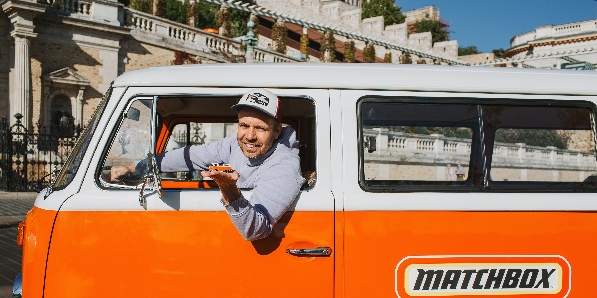

## The Story

A 1976 Volkswagen T2 achieves fame and immortality.

Mattel HungaryOne of the Volkswagen Buses that appears onscreen in Matchbox: The Movie was turned into an actual Matchbox car.Not only is it a faithful re-creation of a 1976 VW T2, but the model even has the actual owner’s Hungarian license plate.The current owner of the T2 made sure to get one of these Matchbox models to the original owner, who started driving it 50 years ago.Filmed in Budapest and Bratislava, Matchbox: The Movie has a fairly tenuous connection to the little die-cast toys. Starring the always charismatic John Cena as a CIA agent racing to deal with a rogue nuclear weapon, the central conceit is that a group of friends who used to play together with Matchbox cars in middle school reunite in adulthood to take down the bad guys.

It’s a movie that plays like a kid narrating a story while pushing die-cast cars around the carpet, which feels like a pretty good fit for the brand association. Compared to Hot Wheels, which are all about speed and pulling off loops on those iconic orange tracks, Matchbox as a brand skews a little more realistic, and often features construction machines and vintage vehicles.

Speaking of iconic orange, one of the central vehicles onscreen is a 1970s Volkswagen T2, the beloved Microbus. These things are such a huge part of popular culture that one was the main plot point in an episode of Futurama, which saw the crew hopping into a VW Bus and following Beck’s band around. (Best joke: When asked by Professor Farnsworth where the onboard time dilation device is, Fry reaches under the seat and produces a bong.).

In this case, two VW T2s were used in filming, both owned by Budapest-based Dávid Sipos. One of the two needed sufficient modification for stunt driving that it ended up no longer road legal, but the more original of the pair survived the filming schedule unscathed and came back into Sipos’s possession. As a tie-in with the film, Mattel of course produced Matchbox models of the film cars, and Sipos was delighted to find that the blister-pack model of the VW Bus was a faithful match for his car, right down to the aftermarket sunroof and identical Hungarian license plate.

The story gets even better, with the involvement of the original owner who picked up the keys to this orange bus some 50 years ago. If a VW Microbus is a symbol of counterculture in the U.S., that’s not the case overseas. In 1964, reacting to European tariffs on U.S. Chicken products, President Lyndon B. Johnson enacted the so-called “chicken tax,” slapping a 25 percent penalty on various products including imported European light trucks.

This particular 1976 T2B was delivered by train to Budapest for the Hungarian Water Works to use as a service vehicle. A young employee with the last name Thaly drove it right off the rail car at the depot, and it entered fleet service for the next eight years.

In more recent times, Sipos was working for an advertising agency that often landed accounts for youth-oriented brands. “Somehow I was always the one suggesting that we should have a VW Bus covered in the brand’s graphics as part of the campaign,” he says.

“There’s something about traveling in a VW Bus that instantly creates a sense of community,” Sipos says. The T2 became something of a signature of the agency, with friends and colleagues often flagging likely-looking vehicles up for sale. One day in 2013, Thaly’s beloved orange VW cropped up in a listing, and while the advertising company didn’t need it in the fleet, Sipos bought it as a personal vehicle.

This T2 ended up onscreen when Matchbox's director, Sam Hargrave, spotted a photo of it. Sipos also had a second, very similar T2 at the time, green in color, and it was the latter that was cloned to look like the 1976 T2B and modified for stunt work.

## Why It Matters

Mattel HungaryOne of the Volkswagen Buses that appears onscreen in Matchbox: The Movie was turned into an actual Matchbox car.Not only is it a faithful re-creation of a 1976 VW T2, but the model even has the actual owner’s Hungarian license plate.The current owner of the T2 made sure to get one of these Matchbox models to the original owner, who started driving it 50 years ago.Filmed in Budapest and Bratislava, Matchbox: The Movie has a fairly tenuous connection to the little die-cast toys.

<figure class="article-inline-img">
  
  <figcaption class="img-credit">Source: caranddriver.com (original article)</figcaption>
</figure>

## CarMotion Daily's Take

As a tie-in with the film, Mattel of course produced Matchbox models of the film cars, and Sipos was delighted to find that the blister-pack model of the VW Bus was a faithful match for his car, right down to the aftermarket sunroof and identical Hungarian license plate. The detail bears tracking. Supply chains, regulations, and consumer demand are reshaping the playbook faster than five-year plans can keep up. Dealer networks and service capacity will need to evolve alongside whatever the headline announcement implies. Regulatory filings, supplier contracts, and any production-volume adjustments usually trail the headline by a quarter or two. Stock price moves and dealer council chatter are leading indicators worth monitoring.

---

📝 Source & Copyright Notice

  <strong>Original Source:</strong> 
  This story was first reported by <strong>CarAndDriver</strong>.
  For the full article with original photography and complete coverage, visit the source:
  <a href="https://www.caranddriver.com/features/a74263645/hungarian-vw-microbus-matchbox-the-movie/" target="_blank" rel="noopener">Read the full story at CarAndDriver →</a>

  ⚠️ <strong>Copyright Notice:</strong> CarMotion Daily is an automated news aggregation service.
  We publish short rewritten summaries under Fair Use principles, with links back to the original sources.
  Images are extracted directly from the original news articles via Open Graph protocol, with attribution.
  All trademarks and copyrights belong to their respective owners. For takedown requests, contact us.

