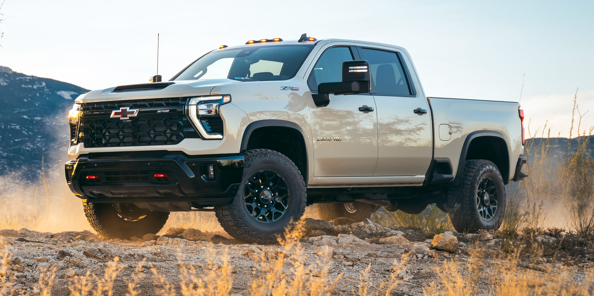

## The Story

The 2027 Chevrolet Silverado HD is a heavy-duty hauler that can be a plush cruiser with the right options.

ChevroletMSRP$49,995–$78,395Shop NewShop UsedGet your trade-in valueHIGHSTwo strong engines, new electric power steering improves handling and maneuvering, spacious cabin.LOWSInterior still trails Ram in luxuriousness, forward visibility impaired by prominent prow.VERDICTThe Silverado HD returns with two new powerful engines that boost it to second place in the HD towing Olympics.For Sale Near YouSee all results for new 2027 Chevrolet Silverado 2500HD / 3500HD for sale near 83.

The 2027 Chevrolet Silverado HD continues its mission to make hauling heavy loads and towing massive trailers as stress-free as possible. A new 412-hp gasoline V-8 and 555-hp turbodiesel V-8, both mated to a 10-speed transmission, help carry out that mission in 2027, with the diesel raising the 3500 HD's max tow rating to a herculean 38,000 pounds when properly equipped.

Expert Tip: The Silverado HD has never been more capable or well-equipped. That said, if you're not regularly towing construction equipment or gigging as a hotshot freight driver, the less expensive Silverado 1500 is rated for up to 13,700 pounds, enough to tug average-sized campers, watercraft, and plenty more.

Compare the 2027 Chevrolet Silverado 2500HD / 3500HD with the top vehicles in this segment with our new compare tool. While the basic exterior and interior carry over unchanged, big news can be found under the hood. Specifically, a 555-hp turbocharged 8.3-liter Mongoose diesel engine and a 412-hp 6.6-liter V-8. New four-piston, 14.6-inch calipers are on duty to help with stopping the big loads. A new haul/tow mode optimizes throttle, transmission, and braking operation for smoother operation, and new off-road mode allows for more wheelspin when that's needed to get you unstuck. The Silverado takes a big step by replacing the traditional hydraulic steering with a new electric power steering system. Adaptive cruise control is now standard equipment.

An updated gasoline 6.6-liter V-8 rated for 412 horsepower and 472 pound-feet of torque serves as the base engine. Cooling and lubrication have been improved to perform better under duress when towing or carrying a max payload. A new 8.3-liter Duramax diesel, dubbed &quot;Mongoose,&quot; produces 555 horsepower and 1230 pound-feet of torque. Both engine options are connected to an Allison 10-speed automatic transmission. During our first drive of the diesel, we tugged a massive 37,000 pounds and found it more than capable, and the upgraded brakes let us haul the load down to a stop with confidence. This, combined with the new electric power steering, conspired to make the Silverado HD feel far less cumbersome at the wheel while retaining its heavy-duty levels of capability.

Car and Driver calculates your car's value in three free and easy steps - using the same Black Book® data dealers use to appraise vehicles. In Comparison: Chevrolet hasn't released any 0-60 figures, but based on our preliminary estimates, the 2027 Silverado HD will run neck and neck with its Ram and Ford competitors. We'll update this section with official C/D testing results as soon as the numbers are available.

Towing and payload ratings are the barometer by which all heavy-duty trucks are measured. The gasoline-powered 2027 Silverado HD can tow up to 20,000 pounds, and the diesel version can pull up to 38,000 pounds. While max towing is up, payloads have decreased slightly: the gasoline version's 6,990-pound payload is down 300 pounds from last year, and the diesel's 6170 rating is down 474 pounds.

In Comparison: The max towing figure for the Ram 3500 is 36,610 pounds with the diesel engine; its max payload is 7590 pounds with the gas engine. Since the EPA doesn't test vehicles as heavy as the Silverado HD and its colossal competitors, we can only judge their real-world mpg on our 75-mph highway fuel economy route. Based on the 18 mpg that the last 2024 Silverado 2500 Duramax diesel returned in C/D testing, we estimate that the Mongoose diesel will match that. We'll update this section with 2027 HD results as soon as we have one for testing.

In Comparison: A 2023 Ford Super Duty F-250 SuperCrew 4x4 with the high-output Power Stroke diesel achieved 20 mpg in our 75-mpg test. First Row: The heavy-duty Silverado runs the gamut from a stripped-down two-door work truck with a 40/20/40 split vinyl bench seat to a dressed-up crew cab with perforated leather buckets. All feature a mountainous dashboard packed with easy-to-use switchgear.

## Why It Matters

This, combined with the new electric power steering, conspired to make the Silverado HD feel far less cumbersome at the wheel while retaining its heavy-duty levels of capability.

<figure class="article-inline-img">
  
  <figcaption class="img-credit">Source: caranddriver.com (original article)</figcaption>
</figure>

## CarMotion Daily's Take

In Comparison: Chevrolet hasn't released any 0-60 figures, but based on our preliminary estimates, the 2027 Silverado HD will run neck and neck with its Ram and Ford competitors. Watch this space over the coming weeks. Electric momentum is uneven across the industry, and moves like this reshape how buyers compare EV lineups. Range, charging speed, and price still dominate EV shopping — every new entry forces competitors to either match or reposition. Watch for EPA range certifications and DC fast-charge benchmarks once independent tests land. Pricing tiers, software updates, and any regional trim adjustments will tell us how serious the launch intent is.

---

📝 Source & Copyright Notice

  <strong>Original Source:</strong> 
  This story was first reported by <strong>CarAndDriver</strong>.
  For the full article with original photography and complete coverage, visit the source:
  <a href="https://www.caranddriver.com/chevrolet/silverado-2500hd-3500hd-2027" target="_blank" rel="noopener">Read the full story at CarAndDriver →</a>

  ⚠️ <strong>Copyright Notice:</strong> CarMotion Daily is an automated news aggregation service.
  We publish short rewritten summaries under Fair Use principles, with links back to the original sources.
  Images are extracted directly from the original news articles via Open Graph protocol, with attribution.
  All trademarks and copyrights belong to their respective owners. For takedown requests, contact us.

