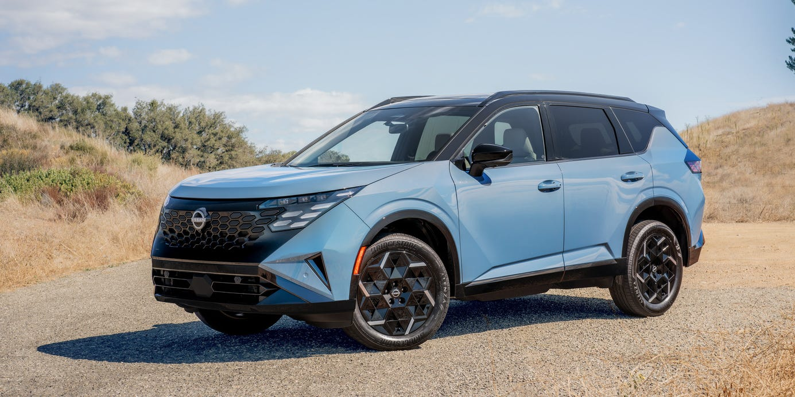

## The Story

Using an electric motor to provide propulsion makes the Rogue relaxed, easygoing, and frugal.

NissanJump to:How Does It Drive?What’s It Like to Live With?Should I Buy One?Highlights and LowlightsThe Rogue is by far Nissan’s best seller in the United States, with the brand shifting more than 200,000 units of the compact crossover last year. So the company can’t afford to screw with it whimsically. That’s why there are soon to be two Rogues. The regular version will continue to be produced by Nissan’s giant plant in Smyrna, Tennessee. And the new 2027 Rogue Hybrid tested here will be imported from Japan. Despite its name, the Hybrid isn’t just to keep up with gasoline-electric rivals—it’s a fundamental step beyond them.

A serial hybrid is, to oversimplify only slightly, an electric powertrain lashed to an internal-combustion engine that acts as a generator to produce current. That current is delivered to a battery and electric motors that do the propulsive work. There is no direct, mechanical drive from engine to road; traction is all delivered electrically. Like a diesel-electric railroad locomotive. That spares buyers the need to live with a constantly variable transmission. For which, hallelujah.

The engine is a 1.5-liter turbocharged three-cylinder making 148 hp and 171 lb-ft in its own right and working in conjunction with a dinky 1.67-kWh lithium-ion battery pack. Drive is delivered through two electric motors, one turning each axle, with a peak system output quoted at 225 hp.

Since this is an electric crossover that happens to have an internal-combustion engine aboard, it drives very much like other electrics. That includes one-pedal driving with regenerative braking in “e-Pedal” mode. It’s more Leaf than Pathfinder or regular Rogue.

Historically, Nissan has done a great job of tuning every Rogue’s suspension for its duty of prowling across every obstacle suburbia throws at it. It crosses Costco speed bumps confidently, doesn’t chunk up when sliding across a curb during parallel parking, and steers precisely and confidently when sneaking into a garage full of bicycles and long disused exercise equipment.

The dry roads of Santa Barbara County in October are no challenge for any all-wheel-drive system. That in mind, the Rogue Hybrid makes effective use of its 235-mm-wide all-season radials (on 18-inch wheels in the base SV and 19s with the SR and Platinum). With much of its battery and electric motor weight carried low, Nissan claims a weight distribution of 56 percent front and 44 percent rear for the test vehicle. The conventional Rogue carries about 60 percent of its weight on its nose.

This is not a fire-breathing electric. Acceleration is nicely linear as with, say, the Leaf or a Chevrolet Bolt. Because 225 hp can push two tons and then some only so quickly, 0–60 is likely in the mid-six-second range, and the quarter-mile will be just under 16-seconds. It’s roughly comparable to the Leaf.

As nonplussed as the acceleration times will leave those who love to drive, there is the compensation of outstanding fuel economy. The EPA rates the new Rogue Hybrid SR at 41 mpg in the city, 36 mpg on the highway, and 38 mpg combined. That’s up a huge 12 mpg in the city cycle compared with the conventional Rogue Platinum AWD, along with a smaller 4 mpg on the highway and a modest 9 mpg combined.

The rest of the Rogue Hybrid’s mechanical substance is familiar stuff. Many of the structural elements and suspension design carryover from the current conventional Rogue, along with the 106.5-inch wheelbase. The Rogue Hybrid’s 72.8-inch overall width is up 0.4 inch, and the 67.2-inch overall height is down 0.2 inch. Nissan isn’t screwing with what’s working.

Nissan’s interior designers have done an outstanding job of making the new Rogue Hybrid feel roomy. The dash is relatively low below the windshield, and the door panels are shaped for some elbowroom. The seats are also well considered and cushy, which in this class of vehicle is what matters. Eight-way power-adjustable and heated front seats are standard across the line, with the Platinum trim also getting ventilation for cooling and a memory feature. Like giant moonroofs?. One comes standard on the Platinum and optional on the lesser trims.

## Why It Matters

**Nissan**Jump to:How Does It Drive?What’s It Like to Live With?Should I Buy One?Highlights and LowlightsThe Rogue is by far Nissan’s best seller in the United States, with the brand shifting more than 200,000 units of the compact crossover last year.

<figure class="article-inline-img">
  
  <figcaption class="img-credit">Source: roadandtrack.com (original article)</figcaption>
</figure>

## CarMotion Daily's Take

And the new 2027 Rogue Hybrid tested here will be imported from Japan. Watch this space over the coming weeks. Electric momentum is uneven across the industry, and moves like this reshape how buyers compare EV lineups. Range, charging speed, and price still dominate EV shopping — every new entry forces competitors to either match or reposition. Watch for EPA range certifications and DC fast-charge benchmarks once independent tests land. Pricing tiers, software updates, and any regional trim adjustments will tell us how serious the launch intent is.

---

📝 Source & Copyright Notice

  <strong>Original Source:</strong> 
  This story was first reported by <strong>RoadandTrack</strong>.
  For the full article with original photography and complete coverage, visit the source:
  <a href="https://www.roadandtrack.com/reviews/a74374933/tested-2027-nissan-rogue-hybrid-is-more-electric-than-gas/" target="_blank" rel="noopener">Read the full story at RoadandTrack →</a>

  ⚠️ <strong>Copyright Notice:</strong> CarMotion Daily is an automated news aggregation service.
  We publish short rewritten summaries under Fair Use principles, with links back to the original sources.
  Images are extracted directly from the original news articles via Open Graph protocol, with attribution.
  All trademarks and copyrights belong to their respective owners. For takedown requests, contact us.

