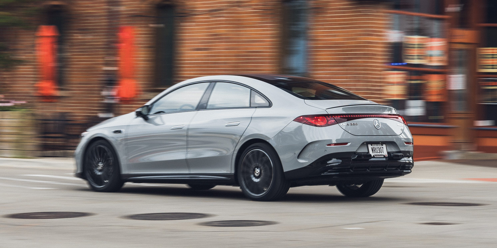

## The Story

Mercedes brings some luxury elements to a lower price point, but not always the right ones.

View exterior photosMichael Simari|Car and DriverThe glamour of a Mercedes, the ease and efficiency of an electric drivetrain, and an affordable price tag: That’s the premise of Mercedes-Benz’s entry-level CLA-class, which offers some of the same high-end features found on Mercedes’s big nameplates in a smaller, more cost-effective package. It’s an ambitious goal, and the electric 2027 CLA350 hits some of its selling points better than others, but it doesn’t cross everything off the list.

The CLA’s exterior styling would be most politely described as “ovoid elegance.” Think Fabergé on wheels, with intricately detailed LED headlights and a plethora of three-pointed stars, including a massive, illuminated badge in the center of the grille. If you’re paying to make sure people know it’s a Mercedes, you’re getting your money’s worth; not only is the center badge surrounded by 142 twinkly little light-up stars, but the 18- and 19-inch wheel options, the taillights, and the decklid all don Mercedes’s cosmic callouts too.

Like a Fabergé, the CLA350 hopes to dazzle with interior details as well, so the cabin features illuminated climate control vents, door panels, and a center console with floating architectural details. Reflecting it all on our tester is a dash-wide Superscreen display, part of the top-range $5850 Pinnacle Line trim package. On cars without the optional passenger screen, there’s a polished star-studded panel on the right side to make sure there’s no corner of the CLA that isn’t glossy and glassy.

The downside of all this sculptural interior design is a loss of cabin space. The door panels and seat controls protrude inward, and the console sits high in the center, its harder plastic points exerting a gravitational pull to elbows and knees. The seats are comfortable and adjustable, but there are so many less forgiving surfaces surrounding the seating areas that the cabin can feel claustrophobic, like trying to sit on the couch in an overly decorated house. There’s a real fear of knocking over a vase. Things don’t improve in the rear seat, which we also found cramped. It’ll do in a pinch, but it is a pinch, especially for tall passengers or bulky child safety seats. Too bad folks can’t ride in the cargo area, which offers a deep-set 10 cubic feet in the rear and a single snack-sized cube in the frunk.

Despite the danger to funny bones, the CLA is an enjoyable driving experience. The 350 is a more powerful version of the 268-hp CLA250+ model, combining a 107-hp front motor and a 242-hp rear unit for all-wheel drive, 349 horsepower, and 380 pound-feet of torque. A two-speed transmission on the rear axle helps make power delivery more efficient, especially during highway drives. At the test track, the dual-motor 350 outran the 250+ with a quarter-mile time of 12.9 seconds compared to the single-motor’s 14.5-second run. It’s quicker from the get-go, taking only 4.3 seconds to hit 60 mph, as opposed to the CLA250+’s 5.8 seconds. Neither CLA is headed for racetrack domination, but the CLA350 makes short work of freeway merges.

Ride quality isn’t as plush as it is in higher-priced Mercedes offerings, but we found the CLA quiet and comfortable with responsive steering, an easy way to commute. Adjustable brake regeneration settings allow for all manner of operation, from fully fledged one-pedal driving to a barely-there glide. We liked that last choice the best, as it offered a nice mix of brake assist while allowing enough creep to move through stop-and-go traffic naturally. In terms of grip, the CLA came to a halt from 70 mph in 161 feet, and it exhibited some moderate understeer around the skidpad, where it pulled 0.85 g of stick.

Rather than all-out performance, Mercedes’s main focus with the CLA is tech and software. It’s a screen-based cabin, with data spread across a 10.3-inch gauge cluster, a 14.0-inch touchscreen, and (if so optioned) in a head-up display and a second 14.0-inch screen in front of the passenger. We’ve yet to run into a passenger who wants to poke at their unflattering reflection in any of these new passenger-side screens, but if your guests would rather watch Disney+ than converse, that’s now a possibility.

Another trend that’s found its way down the price range is adjustable cabin mood lighting. In the CLA, a pastel glow runs in strips along the dash and doors and circles the air vents in customizable colors. Actual sunlight, if you’re so inclined, can be softly filtered through the panoramic glass roof with the optional $1050 Sky Control electrochromic transparency feature, which adjusts opacity for the whole roof or in stylish striped segments. Other fancy-feeling features include an automatic trunk close (part of the Pinnacle trim), a center airbag, and the option for a 16-speaker Burmester 3D surround-sound stereo.

Many of these high-end additions are welcome, but Mercedes also made some strange decisions here. We would have happily sacrificed the mood lighting in exchange for massaging seats, a standard heated steering wheel, or—perhaps most of all—four window switches, rather than two switches and a toggle to control the rear doors. On the same theme of “just give us a button,” controls for lumbar support and climate settings are buried in the center screen, making adjustments finicky once you’ve embarked.

If the CLA falls short on the infotainment user experience, it makes up ground when it comes to charging and range. Both CLA variants use an 800-volt architecture with an 85-kWh nickel-manganese-cobalt (NMC) battery and a 320-kW DC fast-charge peak rate. We haven’t had a chance to do our real-world range test on the 350 yet, but it’s EPA-rated at 312 miles of range, and Mercedes says it should recharge from 10 to 80 percent in about 22 minutes. The 250+ model beat its official range estimate in our testing, so we wouldn’t be surprised if the 350 impresses as well.

The CLA delivers handily on the promise of electric performance and efficiency. Glamour is more subjective, but the CLA offers numerous options for interior materials and additional cosmetic packages to set it apart from the average transportation pod. At its starting point, it’s even affordable, but our test car’s reasonable $51,950 base price shot up fast with add-on features. It’s a rough world when $67,980 (as-tested) is an entry-level price and doesn’t even get you leather upholstery. It’s no S-class, but what do you expect from the opposite side of the alphabet?.

## Why It Matters

Like many girls, she planned to be a vet-astronaut-artist, and came closest to that last one by attending UCLA art school.

<figure class="article-inline-img">
  
  <figcaption class="img-credit">Source: caranddriver.com (original article)</figcaption>
</figure>

## CarMotion Daily's Take

2027 Mercedes-Benz CLA350 4Matic Electric
Vehicle Type: front- and rear-motor, all-wheel-drive, 5-passenger, 4-door sedan. The detail bears tracking. Electric momentum is uneven across the industry, and moves like this reshape how buyers compare EV lineups. Range, charging speed, and price still dominate EV shopping — every new entry forces competitors to either match or reposition. Watch for EPA range certifications and DC fast-charge benchmarks once independent tests land. Pricing tiers, software updates, and any regional trim adjustments will tell us how serious the launch intent is.

---

📝 Source & Copyright Notice

  <strong>Original Source:</strong> 
  This story was first reported by <strong>CarAndDriver</strong>.
  For the full article with original photography and complete coverage, visit the source:
  <a href="https://www.caranddriver.com/reviews/a74334140/2027-mercedes-benz-cla350-4matic-ev-test/" target="_blank" rel="noopener">Read the full story at CarAndDriver →</a>

  ⚠️ <strong>Copyright Notice:</strong> CarMotion Daily is an automated news aggregation service.
  We publish short rewritten summaries under Fair Use principles, with links back to the original sources.
  Images are extracted directly from the original news articles via Open Graph protocol, with attribution.
  All trademarks and copyrights belong to their respective owners. For takedown requests, contact us.

