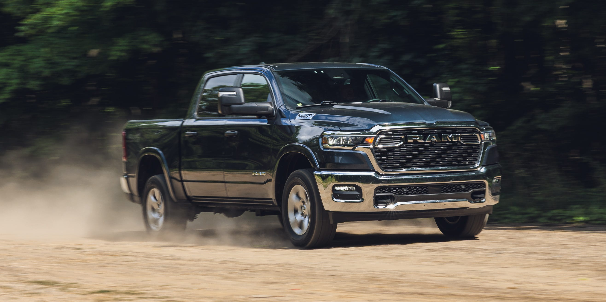

## The Story

Over 40,000 miles of towing, hauling, and road tripping, our six-cylinder Ram acted more like a BMW wearing Carhartt.

View exterior photosMichael Simari|Car and Driver40,000-Mile WrapOur expectations for the Ram 1500 are well established. This being the third 1500 of the current generation we’ve put through a long-term test, the only real question mark was under the hood.

For 2025, Ram pulled the Hemi V-8 from the lineup. In its place came the Hurricane: a twin-turbocharged 3.0-liter inline-six making 420 horsepower and 469 pound-feet of torque in its base form. Sure, that’s more power than the Hemi produced, but some buyers hold V-8-powered full-size trucks as a fundamental truth, right next to basic arithmetic and gravity. These folks would probably dismiss the Ram’s twin-turbo six outright. Their loss.

Over 40,000 miles, our Big Horn 4x4 model was a six-passenger, 5765-pound workhorse for all manner of tasks: towing trailers, swallowing luggage, devouring interstate miles, and hauling the kind of oversize objects people buy because they have access to a pickup, a credit card, and a Costco membership.

With the Hurricane, the Ram proved smooth, strong, and surprisingly sophisticated, like a BMW wearing Carhartt. We loved its power too. Our initial testing logged 60 mph in 4.8 seconds and the quarter-mile in 13.6 seconds at 100 mph. That’s serious pace for a crew-cab pickup on Falken Wildpeak all-terrain tires, and it was 1.3 seconds quicker to 60 mph than the 395-hp 5.7-liter V-8–powered 2019 Ram 1500 we ran through a 40,000-mile test. Our 2025 example repeated its 60-mph time at 40,000 miles, though its quarter-mile effort slipped a little to 13.8 seconds at 96 mph. Still, leave it in rear-drive mode, and the traction-control light will occasionally flicker during moderate freeway acceleration in the wet. That is not a complaint.

Indeed, driving the Ram 1500 leads to few complaints, which is why it’s been on our 10Best list eight times. The 1500, with its four-corner coil-spring suspension, rode with the calm authority that has long separated this truck from its rear-leaf-spring competitors, cruising and towing with the ease of a long-legged Clydesdale at a trot and making you wonder why other pickups don’t ride this well.

The Ram was a happy mile eater, as the optional 33.0-gallon fuel tank regularly showed more than 500 miles of indicated range after a fill-up. The cabin was a great place to while away the hours. Ram has been doing excellent truck interiors long enough that the surprise has worn off, but the usefulness remains. The front bench gave us seating for six and a healthy dose of nostalgia, the rear seat offered limo-like sprawl-out space, and the front armrest placed a hand naturally in line with the shifter and stereo controls.

Our most vocal complaints fell on the large mirrors from the Trailer-Tow Group package. They were fantastic when there was a trailer behind you and a nuisance when there wasn’t, blocking entire cars at roundabouts and requiring chicken-like head bobbing to see around them.

Worse, the mirrors fold and extend manually on this near-$70,000 truck (power-extending and folding mirrors are available). Also missing is passive entry, because Ram limited its availability for 2025 to Laramie and higher trims, and we didn’t notice when we ordered ours. Oops. We did go for the Big Horn Level 2 Equipment Group, which adds a 12.0-inch touchscreen, heated front seats, a heated steering wheel, dual-zone climate control, navigation, and a larger digital display in the instrument cluster. Keyless entry should be part of that package. Having to get the key fob out to unlock the doors would be acceptable on a contractor-spec truck. Or in the year 2015.

Fuel economy was the other great qualifier. We averaged 15 mpg; our long-term 2019 Ram V-8 managed 14. On our 75-mph highway fuel-economy test, the new Ram returned 18 mpg while the V-8 logged 17. A real-world 1-mpg improvement isn’t the efficiency promise we were told would justify ditching two cylinders. Instead, the Hurricane delivered improved acceleration, which is arguably a better bargain.

The last great frustration was our dealer’s service center and how often we visited it. Scheduled maintenance came at 10,000-mile intervals. Each appointment at Suburban Chrysler Dodge Jeep Ram of Ann Arbor was more expensive than we expected. Examples included $60 for a cabin air filter that retails online for roughly half that and added services that aren’t in the owner’s manual.

High prices didn’t end at the service department either. A plastic clamp and a section of railing broke on our trifold tonneau cover, likely from one of us loading the bed with more enthusiasm than finesse. A replacement tonneau cost $2200 at the parts counter, which is curious considering it was a $550 factory option. We replaced the broken pieces instead, but even those bits cost $148. All in, our out-of-pocket maintenance costs amounted to $829.

## Why It Matters

2025 Ram 1500 Big Horn 4X4
Vehicle Type: front-engine, rear/4-wheel-drive, 6-passenger, 4-door pickup.

<figure class="article-inline-img">
  
  <figcaption class="img-credit">Source: caranddriver.com (original article)</figcaption>
</figure>

## CarMotion Daily's Take

Later, a malfunctioning forward-collision system required a dealer visit to swap the long-range radar module. Watch this space over the coming weeks. Supply chains, regulations, and consumer demand are reshaping the playbook faster than five-year plans can keep up. Dealer networks and service capacity will need to evolve alongside whatever the headline announcement implies. Regulatory filings, supplier contracts, and any production-volume adjustments usually trail the headline by a quarter or two. Stock price moves and dealer council chatter are leading indicators worth monitoring.

---

📝 Source & Copyright Notice

  <strong>Original Source:</strong> 
  This story was first reported by <strong>CarAndDriver</strong>.
  For the full article with original photography and complete coverage, visit the source:
  <a href="https://www.caranddriver.com/reviews/a64034818/2025-ram-1500-big-horn-reliability-maintenance/" target="_blank" rel="noopener">Read the full story at CarAndDriver →</a>

  ⚠️ <strong>Copyright Notice:</strong> CarMotion Daily is an automated news aggregation service.
  We publish short rewritten summaries under Fair Use principles, with links back to the original sources.
  Images are extracted directly from the original news articles via Open Graph protocol, with attribution.
  All trademarks and copyrights belong to their respective owners. For takedown requests, contact us.

