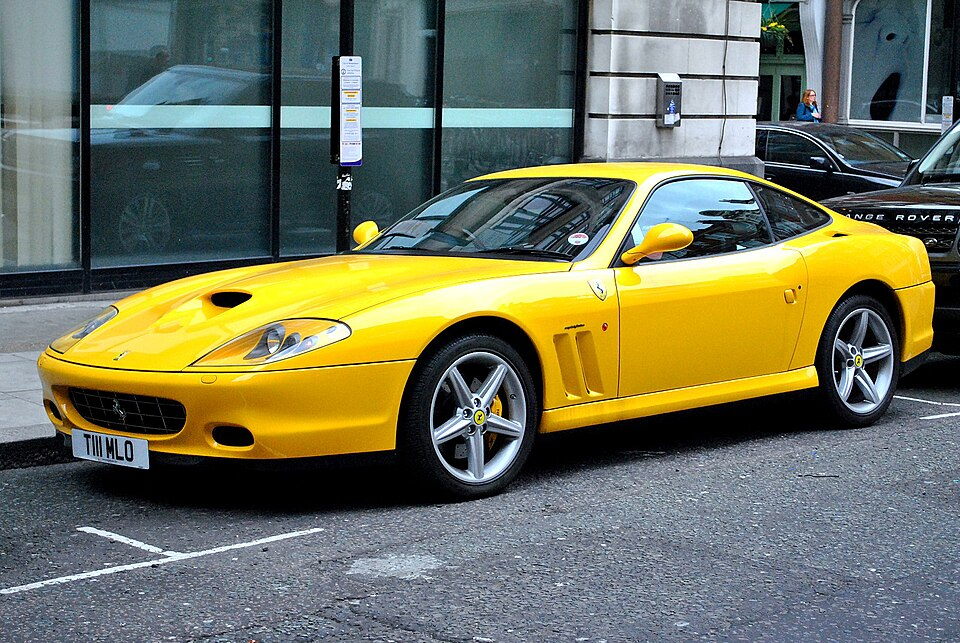
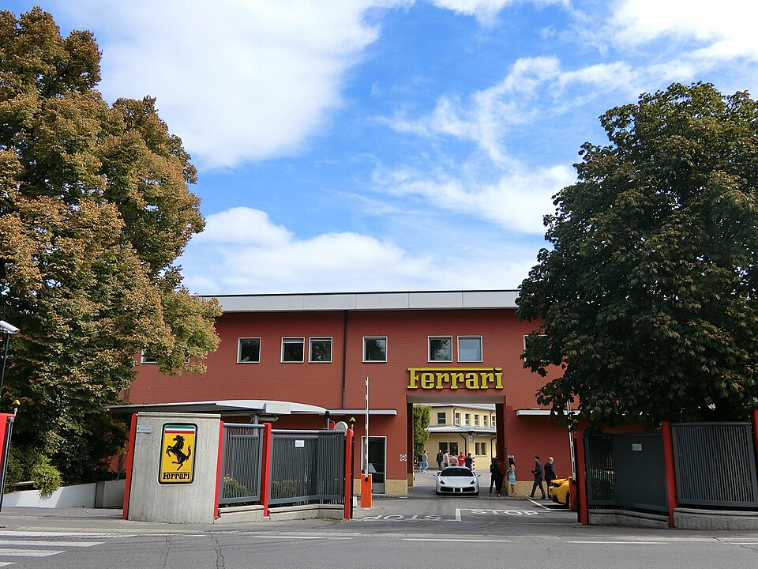

## The Story

The decision to revert to a front-engined layout for the 550 Maranello led to a seminal Ferrari grand tourer, which today can be yours for £100k.

When the 550 Maranello was revealed to the press at the Nürburgring in July 1996, you didn’t need a deerstalker to work out where Ferrari had looked for inspiration. The long, thrusting bonnet and short, clenched tail; the four round tail-lights; just two seats in a sumptuously furnished cockpit, and a big, naturally aspirated V12 engine up front. Spiritually, conceptually and materially, the Maranello was the Daytona reborn.

It was president Luca di Montezemolo who had decreed that Ferrari’s new series-production flagship should be front-engined, bringing to an end a 23-year-long line of flat-12 mid-engined supercars that stretched from Berlinetta Boxer through Testarossa to F512M. His reasoning was that a front-engined super-GT would be more useable, more driveable than a mid-engined exotic, and he was absolutely right. So right, in fact, that today’s 12 Cilindri still follows the template set by the 550 Maranello all those years ago.

The name combined references to the 5.5-litre capacity of the V12 engine and, of course, Ferrari’s home town. The styling was by Lorenzo Ramaciotti at Pininfarina, and as well as borrowing cues from the Daytona, it also included a visual nod to that car’s predecessor, the 275 GTB, in the form of the gills in the front wings. This was Ferrari unashamedly summoning the spirit of its legendary 1960s berlinettas.

As a road car, the 550 achieved greatness. The V12 engine was and is a wonderful thing, delivering a creamy torrent of power and torque, and the handling was so deft, more like that of a lightweight sports car than a GT. It’s one of Maranello’s best and a defining supercar of the 1990s – when you consider you can pick one up for less than £100k on the used market (the price of a basic 911 Carrera), it’s also a bit of a supercar bargain.

The 5.5-litre, 48-valve, quad-cam, dry-sumped V12 (codenamed F133A) was a reworked and more highly tuned version of the F116 engine that had made its debut in the four-seater 456 GT in 1992. The main changes were redesigned cylinder heads and what Ferrari called a ‘resonance effect’ induction system with 12 throttle valves and variable-length inlet tracts to boost both low-rev grunt and top-end zing. It’s a remarkable engine, blending abundant power – a peak of 478bhp at 7000rpm – with genuine GT refinement. Ferrari claimed 0-62mph in 4.4sec and a top speed of 199mph.

Supercars didn’t make noise for the sake of it in the ’90s but the Maranello is, sadly, particularly muted. The V12 is silk-smooth and apparently able to pull any gear at any revs. It still feels quick; maybe not spin-the-planet-backwards quick like a current-era Ferrari but still more than fast enough to make a serious impression.

Despite the F1 paddleshift gearbox having already appeared in the F355, the 550 was offered only with a traditional manual gearbox, a rear-mounted six-speeder that was combined with the limited-slip differential. That manual gearbox with its exposed metal gate is key to the car’s appeal. Although this was a thoroughly modern Ferrari at the time, it was also a front-engined GT in the classical idiom.

The 550’s steel structure was derived from the 456, although at 98.4in (2500mm) the 550’s wheelbase is shorter by 3.9in. Suspension is by double wishbones all round, with electronically adjustable damping and a Sport setting to stiffen its sinews. Magnesium alloy wheels and aluminium calipers keep unsprung weight down, while the optional Fiorano pack makes the handling tauter still, at the cost of a slight degradation in ride quality. The steering has variable power assistance depending on road speed; braking is by big, vented iron discs with anti-lock, and there’s ASR stability control that can be switched to a lower level of intervention or turned off altogether.

Despite the conventional front-engined layout, there’s still a vague hint of the long-arm, short-leg driving position you get in older mid-engined Ferrari GTs, like the Testarossa. Your knees are slightly splayed either side of the steering column, yet the wheel is somehow a little high and far away. It’s best if you slouch slightly and adopt a nonchalant attitude.

The fitment of power steering imbues the 550 with a real sense of nimbleness. It’s a quick rack at a little more than two turns lock-to-lock but there’s something else at play in the chassis set-up that gives it remarkable agility. It’s almost as if it has rear steering: as soon as you turn in – enjoying the speedy steering and blending off the short-travel brake pedal, which is full of feel – it yaws slightly at the rear. Not oversteer (though that’s there to be taken if you want), rather the Ferrari’s natural cornering stance is to subtly pivot its hips towards the apex.

It makes for a really intuitive and exciting car, one that’s much more wieldy than you’d expect given the big V12 in the nose. There’s a clear thread between the 550 and today’s 12 Cilindri, both being easy, refined and gentlemanly to drive, but emphatically thrilling when the mood takes you. It’s hard not to be bewitched by its character.

## Why It Matters

Suspension is by double wishbones all round, with electronically adjustable damping and a Sport setting to stiffen its sinews.

<figure class="article-inline-img">
  
  <figcaption class="img-credit">Source: Wikipedia / Ferrari 575M Maranello</figcaption>
</figure>

## CarMotion Daily's Take

It’s one of Maranello’s best and a defining supercar of the 1990s – when you consider you can pick one up for less than £100k on the used market (the price of a basic 911 Carrera), it’s also a bit of a supercar bargain. The detail bears tracking. Electric momentum is uneven across the industry, and moves like this reshape how buyers compare EV lineups. Range, charging speed, and price still dominate EV shopping — every new entry forces competitors to either match or reposition. Watch for EPA range certifications and DC fast-charge benchmarks once independent tests land. Pricing tiers, software updates, and any regional trim adjustments will tell us how serious the launch intent is.

<figure class="article-inline-img">
  
  <figcaption class="img-credit">Source: Wikipedia / Ferrari</figcaption>
</figure>

---

📝 Source & Copyright Notice

  <strong>Original Source:</strong> 
  This story was first reported by <strong>Evo-GN</strong>.
  For the full article with original photography and complete coverage, visit the source:
  <a href="https://news.google.com/rss/articles/CBMiVkFVX3lxTE1mUEtWc3VkUVJiX1dNVkJ3R295OTBuY0wxSW53a1ktOGpEbWxrSkNlZ2htT3lNdXdmbElQclY2enRVY3JZUW5rbDVvcW5iYVNaMWNXaER3?oc=5" target="_blank" rel="noopener">Read the full story at Evo-GN →</a>

  ⚠️ <strong>Copyright Notice:</strong> CarMotion Daily is an automated news aggregation service.
  We publish short rewritten summaries under Fair Use principles, with links back to the original sources.
  Images are extracted directly from the original news articles via Open Graph protocol, with attribution.
  All trademarks and copyrights belong to their respective owners. For takedown requests, contact us.

