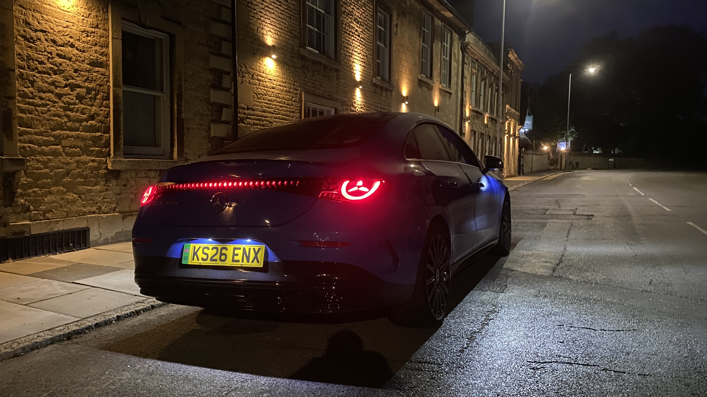
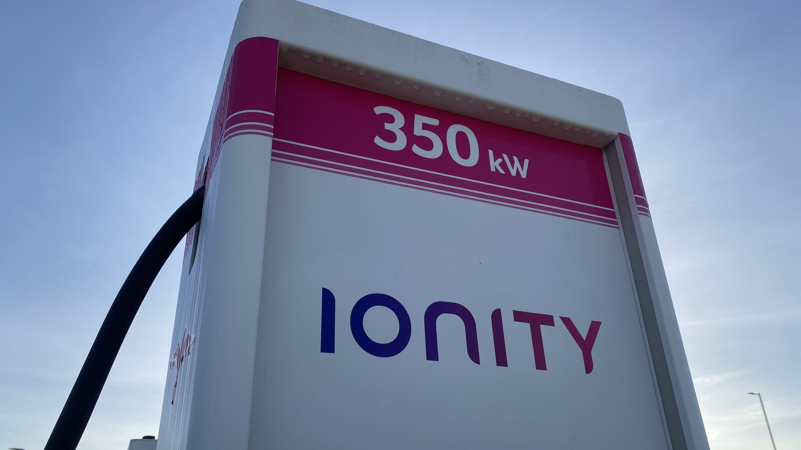

## The Story

... and it almost went perfectly!.

It was almost flawless. Almost as easy as it would’ve been in a combustion car. Some of that wasn’t the blue Benz’s fault – but quite a bit of it was. And if you’re thinking “oh here we go, another two-footed tackle on EVs, range and charging from someone with an agenda”, that’s not me.

One other note: the jolting of the train set off an internal alert – the CLA thought someone had crashed into it. Again. Anyway, j’arrive en France a la 1100 heures, or whatever it was I stumbled through in GCSE French. No headwind, an ambient temperature of around 18 Celsius, and nothing but miles of smooth, flowing French autoroute ahead of me. Bliss. The CLA eats motorways like a much bigger luxury car, in near silence. It’s so refined.

To increase the sense of relaxation, Mercedes recommended I use the car’s built-in nav to guide me (instead of my default choice of Waze and Zapmap apps.). Why?. Because using the integrated nav means the CLA can recommend charging stops, automatically add them to the route, filter by charging speed (I selected only the fastest 150kW+ option) and even keep track of how many are in operation. Plus it’ll pre-condition the battery as the pit-stop approaches, to lessen the charging time. Clever.

What annoyed me wasn’t the Gallic shrugs, but the Mercedes Superscreen. After all, it knew the chargers were being occupied. It has a sub-menu to show that. Why didn’t it simply automatically reroute me to the next free charger?. Merde.

## Why It Matters

To increase the sense of relaxation, Mercedes recommended I use the car’s built-in nav to guide me (instead of my default choice of Waze and Zapmap apps.).

<figure class="article-inline-img">
  
  <figcaption class="img-credit">Source: topgear.com (original article)</figcaption>
</figure>

## CarMotion Daily's Take

Some of that wasn’t the blue Benz’s fault – but quite a bit of it was. The detail bears tracking. Markets rarely reward single announcements — execution over the next two to four quarters is what closes the gap between press release and customer. How this lands depends less on the announcement itself and more on the rollout, dealer support, and after-sales story behind it. Specifics on pricing, availability, and regional rollout will tell us whether this moves from headline to delivery. Independent verification and follow-up coverage from rival outlets tend to firm up the picture within days.

<figure class="article-inline-img">
  
  <figcaption class="img-credit">Source: topgear.com (original article)</figcaption>
</figure>

---

📝 Source & Copyright Notice

  <strong>Original Source:</strong> 
  This story was first reported by <strong>TopGear</strong>.
  For the full article with original photography and complete coverage, visit the source:
  <a href="https://news.google.com/rss/articles/CBMiugFBVV95cUxOWVBHUHZwbE1TSzcyeXRoUTNNdUpZTVFkUEJVUU1mLTFrODhwYlNaZ1EyaThoRzl6TWZvZ21LMUZqcEQydVYtUUl5QnlHZEpKVTFRSU00Zl8zd2o3dXZkQm5mVHVmVGU2ckJ3YkVUcFNPQlNVM1loSlNwMzNzNlpEUnBNM1l3bldQTTVpSVJiQzlqZENta1gxal92bVlxaEZETlpyb25lYjlXX3NSQUpmZUJpYTFQS1lQSkE?oc=5" target="_blank" rel="noopener">Read the full story at TopGear →</a>

  ⚠️ <strong>Copyright Notice:</strong> CarMotion Daily is an automated news aggregation service.
  We publish short rewritten summaries under Fair Use principles, with links back to the original sources.
  Images are extracted directly from the original news articles via Open Graph protocol, with attribution.
  All trademarks and copyrights belong to their respective owners. For takedown requests, contact us.

