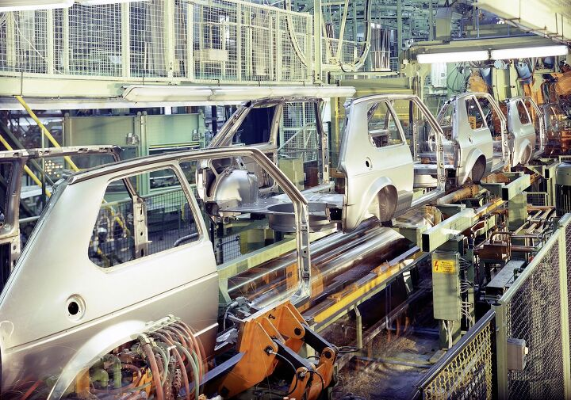

## The Story

The E on a VW manual shifter stands for Efficiency, marking an overdrive gear built for highway cruising in the 3+E and 4+E gearboxes.

Report: GM Allegedly Pumping The Breaks On Full-Size EVs
Connie Peters Drives The 2026 Ford Explorer Tremor
Chinese Vehicle Content Rules Forcing Polestar Out of U.S. Next Year
See Edits
News Blog
Volkswagen
History
NEW!. What The 'E' on a VW Manual Shifter Actually Means
by
TTAC News Staff
(IC: )
Published: November 15th, 2026
Share
If you have ever climbed into an early '80s Volkswagen and found a capital E sitting where fifth gear usually lives, the letter is not a decoration and it has nothing to do with electrification. In Volkswagen's '3+E' and '4+E' gearboxes, the E marks an overdrive slot, a tall ratio designed to drop engine speed, cut wear, and boost fuel economy at highway cruising speeds. You engage it the same way you would any other gear: row up through the numbered gears as the car gathers speed, then slot it into E once you reach the open road.

Add TheTruthAboutCars as a Preferred Source on Google
As for what the letter stands for, drivers at the time guessed liberally. Many assumed it meant "Economy" or an "Extra" gear, which is close enough in spirit but wrong on the badge. Volkswagen's own documents confirm the E stands for "Efficiency," and Car and Driver has backed the same reading for older manual-equipped German cars.

Blame the oil crisis. Stricter fuel economy rules took hold during the oil crunch of the late 1970s and early 1980s, and automakers had to engineer their way out of trouble. Volkswagen's answer was a dedicated manual gearbox whose topmost shift gate carried a capital E.

Mechanically, a car with a 3+E or 4+E transmission drives like any other manual. You row through the gears as the vehicle builds momentum. The difference is only at the top of the pattern.

The U.S.-spec Rabbit is the clearest case study. For 1981, the Rabbit gained a longer-stroke 1.7-liter four-cylinder and a gearbox Volkswagen called the 3+E manual. That gearbox was essentially the previous year's four-speed converted to three gears plus an E overdrive, and both the carryover four-speed and the new 3+E kept an identical 3.89:1 final-drive ratio.

## Why It Matters

Some markets offered a Formula E version of the Golf for the 1981 model year, pairing the 3+E manual with a shift indicator, a readout for fuel use, and a slipperier body that trimmed the drag coefficient.

<figure class="article-inline-img">
  
  <figcaption class="img-credit">Source: thetruthaboutcars.com (original article)</figcaption>
</figure>

## CarMotion Daily's Take

Volkswagen's own documents confirm the E stands for "Efficiency," and Car and Driver has backed the same reading for older manual-equipped German cars. The detail bears tracking. Supply chains, regulations, and consumer demand are reshaping the playbook faster than five-year plans can keep up. Dealer networks and service capacity will need to evolve alongside whatever the headline announcement implies. Regulatory filings, supplier contracts, and any production-volume adjustments usually trail the headline by a quarter or two. Stock price moves and dealer council chatter are leading indicators worth monitoring.

<figure class="article-inline-img">
  
  <figcaption class="img-credit">Source: thetruthaboutcars.com (original article)</figcaption>
</figure>

---

📝 Source & Copyright Notice

  <strong>Original Source:</strong> 
  This story was first reported by <strong>TTAC</strong>.
  For the full article with original photography and complete coverage, visit the source:
  <a href="https://www.thetruthaboutcars.com/cars/news-blog/what-the-e-on-a-vw-manual-shifter-actually-means-45137098?utm_medium=auto&utm_source=rss&utm_campaign=all_full" target="_blank" rel="noopener">Read the full story at TTAC →</a>

  ⚠️ <strong>Copyright Notice:</strong> CarMotion Daily is an automated news aggregation service.
  We publish short rewritten summaries under Fair Use principles, with links back to the original sources.
  Images are extracted directly from the original news articles via Open Graph protocol, with attribution.
  All trademarks and copyrights belong to their respective owners. For takedown requests, contact us.

