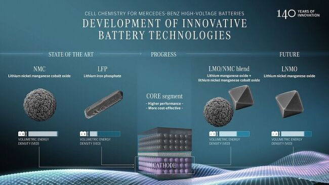

## The Story

Mercedes aims to drop cobalt from EV batteries by 2030 using LNMO chemistry, promising 30% more range than LFP, though hurdles remain.

Report: GM Allegedly Pumping The Breaks On Full-Size EVs
Connie Peters Drives The 2026 Ford Explorer Tremor
Chinese Vehicle Content Rules Forcing Polestar Out of U.S. Next Year
See Edits
News Blog
Mercedes-Benz
Electric vehicles
NEW!. Mercedes Wants Cobalt-Free Batteries by 2030
by
TTAC News Staff
(IC: )
Published: November 17th, 2026
Share
Mercedes-Benz is developing a battery chemistry that drops cobalt entirely, targeting 2030 as the year its product line could run on cells free of the metal. The chemistry in question is lithium-nickel-manganese-oxide, or LNMO, and the pitch is that it removes cobalt while cutting nickel use substantially compared with today's standard nickel-manganese-cobalt cells. More manganese, less of the expensive and ethically fraught stuff.

Enjoy our posts?. Add TheTruthAboutCars as a Preferred Source on Google
The goal is aspirational rather than a hard commitment. Stephan Bach, who leads cell technologies and battery concepts work at Mercedes, has named 2030 as the year the company believes it can equip its lineup with cobalt-free batteries. The automaker will not promise it is fully clear of cobalt by then, and its own LNMO announcement gives no timeline for LNMO-powered cars. Treat the date as a direction of travel, not a delivery guarantee.

Cobalt earns its place in a lithium-ion pack. It forestalls cathode corrosion, lifts efficiency and range, and holds the pack stable, which reduces fire risk. A typical pack carries 10 to 20 pounds of it, at a cost of roughly $100 to $400 per array. That is not a trivial line item across millions of vehicles, and it is one automakers would happily shrink.

Save the Children states that tens of thousands of children work at DRC mine sites daily to help their families get by. The organization cites a child it calls Muntosh. He was 6 years old when his brother died in front of him in a cobalt mine, and he then spent six more years working underground himself because his family needed the money.

So the drive to cut cobalt runs on two tracks at once: cost and supply-chain exposure on one side, and a supply chain that implicates child labor on the other. Either reason alone would justify the engineering effort. Together they make it close to mandatory.

LNMO leans on manganese and runs at high voltage. Mercedes says the chemistry has the potential to operate at up to five volts, and that higher voltage lets a pack hold more energy inside a given space and weight. The upshot, by the company's projection, is up to 30 percent more range than lithium-iron phosphate cells of comparable size and weight.

That 30 percent figure deserves a flag. It is a projection, not a number any production car has delivered. High-voltage operation brings technical challenges of its own, and the chemistry has more development and validation ahead before anyone can say whether the promise holds. Performance, durability, safety, and cost all remain open questions. Mercedes itself has set no concrete timeline for commercial production of LNMO.

The thinking is that eliminating cobalt and leaning on manganese reduces reliance on critical raw materials, which lowers cell costs and shrinks supply-chain vulnerability while, Mercedes hopes, keeping energy density and range competitive.

Cobalt-free batteries already exist and already dominate. Lithium-iron phosphate, or LFP, is an iron-based chemistry that produces inexpensive packs, and it sits in roughly 55 percent of new EVs worldwide, a share padded heavily by Chinese production. Tesla is a major backer of the chemistry.

LFP's catch is energy density. Because it stores less energy per pound, Tesla reaches for high-nickel cells in the longer-range Model 3 and Model Y rather than LFP. That is the gap LNMO is meant to close: a cobalt-free chemistry that doesn't force the range compromise LFP demands. The whole case for LNMO rests on that comparison with LFP, which is why Mercedes frames its range claims against iron-phosphate cells specifically.

Solid-state batteries get discussed as the next leap in EV energy storage. Swapping out the liquid electrolyte, though, does nothing on its own to solve the cobalt problem. Sam Abuelsamid, who runs market research at Telemetry, points out that a solid-state cell can use any chemistry, with or without cobalt. The electrolyte and the cathode chemistry are separate decisions.

## Why It Matters

Next Year
See Edits
News Blog
Mercedes-Benz
Electric vehicles
NEW!.

<figure class="article-inline-img">
  
  <figcaption class="img-credit">Source: thetruthaboutcars.com (original article)</figcaption>
</figure>

## CarMotion Daily's Take

Mercedes Wants Cobalt-Free Batteries by 2030
by
TTAC News Staff
(IC: )
Published: November 17th, 2026
Share
Mercedes-Benz is developing a battery chemistry that drops cobalt entirely, targeting 2030 as the year its product line could run on cells free of the metal. Watch this space over the coming weeks. Markets rarely reward single announcements — execution over the next two to four quarters is what closes the gap between press release and customer. How this lands depends less on the announcement itself and more on the rollout, dealer support, and after-sales story behind it. Specifics on pricing, availability, and regional rollout will tell us whether this moves from headline to delivery. Independent verification and follow-up coverage from rival outlets tend to firm up the picture within days.

<figure class="article-inline-img">
  
  <figcaption class="img-credit">Source: thetruthaboutcars.com (original article)</figcaption>
</figure>

---

📝 Source & Copyright Notice

  <strong>Original Source:</strong> 
  This story was first reported by <strong>TTAC</strong>.
  For the full article with original photography and complete coverage, visit the source:
  <a href="https://www.thetruthaboutcars.com/cars/news-blog/mercedes-wants-cobalt-free-batteries-by-2030-45137122?utm_medium=auto&utm_source=rss&utm_campaign=all_full" target="_blank" rel="noopener">Read the full story at TTAC →</a>

  ⚠️ <strong>Copyright Notice:</strong> CarMotion Daily is an automated news aggregation service.
  We publish short rewritten summaries under Fair Use principles, with links back to the original sources.
  Images are extracted directly from the original news articles via Open Graph protocol, with attribution.
  All trademarks and copyrights belong to their respective owners. For takedown requests, contact us.

