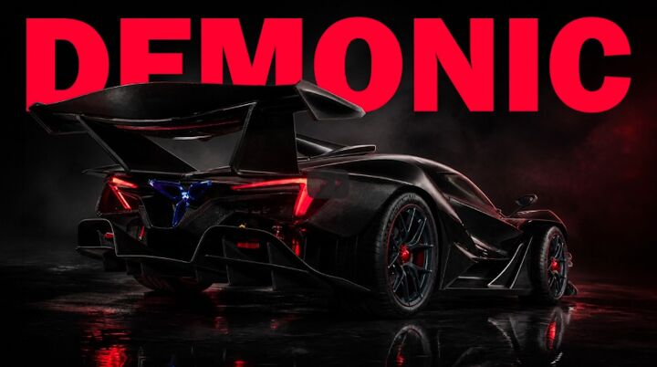

## The Story

The Apollo IE is a V12 hypercar that looks less like a vehicle and more like a demon.See its aggressive aero in action.Most modern cars prioritize practicality or efficiency, but the Apollo IE rejects that entirely.

Report: GM Allegedly Pumping The Breaks On Full-Size EVs
Connie Peters Drives The 2026 Ford Explorer Tremor
Chinese Vehicle Content Rules Forcing Polestar Out of U.S. Next Year
See Edits
News Blog
Podcasts
History
NEW!. Apollo IE: The V12 Hypercar That Looks Like a Demon
by
Chris VS Cars | TTAC Creator
(IC: )
Published: November 18th, 2026
Share
The Apollo IE is a V12 hypercar that looks less like a vehicle and more like a demon. See its aggressive aero in action. Most modern cars prioritize practicality or efficiency, but the Apollo IE rejects that entirely.

Add TheTruthAboutCars as a Preferred Source on Google
This machine is pure theater, built around a naturally aspirated V12 engine that screams as loudly as its bodywork suggests. We look at the extreme aerodynamic features, from the massive rear diffuser to the jagged fins and vents that define its silhouette.

Whether it is caught in a striking purple finish on a quiet country road or pushing limits on a track, the Apollo IE is a masterclass in supercar design. We examine how these aggressive shapes serve a function beyond mere aesthetics, creating a visual presence that few other manufacturers dare to attempt.

With its naturally aspirated V12, exposed carbon-fiber construction, aggressive aerodynamics and deliberately theatrical styling, the IE represented a celebration of old-school hypercar engineering at a time when the industry was increasingly embracing hybrid powertrains and electronic performance technologies.

Apollo Automobil emerged from the remains of Gumpert, the German company known for its brutally effective track-focused supercars. The original Gumpert Apollo prioritized performance and lap times over conventional styling or comfort.

The Intensa Emozione, which translates from Italian as "intense emotion," became Apollo's first major statement under its new identity. Development involved several engineering partners, including Manifattura Automobili Torino and HWA AG. HWA brought considerable motorsport expertise and connections to Mercedes-AMG's racing operations, helping ensure the IE was more than an elaborate styling exercise.

Production was planned for just 10 examples, with an original price of approximately €2.3 million, or roughly $2.7 million. At the heart of the Apollo IE is a 6.3-liter naturally aspirated V12 derived from Ferrari architecture and developed specifically for the project.

The decision to use a naturally aspirated V12 was central to the car's identity. Unlike contemporary hypercars that relied on turbocharging, hybrid assistance and electric motors to deliver enormous performance, the Apollo emphasized engine sound, high-revving power delivery and mechanical engagement.

Its six-speed sequential transmission reinforced that philosophy. Rather than using a smoother dual-clutch gearbox, Apollo chose a more mechanical racing-style setup that delivered abrupt, purposeful shifts.

## Why It Matters

Apollo IE: The V12 Hypercar That Looks Like a Demon
by
Chris VS Cars | TTAC Creator
(IC: )
Published: November 18th, 2026
Share
The Apollo IE is a V12 hypercar that looks less like a vehicle and more like a demon.

<figure class="article-inline-img">
  
  <figcaption class="img-credit">Source: thetruthaboutcars.com (original article)</figcaption>
</figure>

## CarMotion Daily's Take

Instead, Apollo offered something different: an experience in which the driver could feel the engine, transmission, brakes, tires and aerodynamic forces working together. Watch this space over the coming weeks. Supply chains, regulations, and consumer demand are reshaping the playbook faster than five-year plans can keep up. Dealer networks and service capacity will need to evolve alongside whatever the headline announcement implies. Regulatory filings, supplier contracts, and any production-volume adjustments usually trail the headline by a quarter or two. Stock price moves and dealer council chatter are leading indicators worth monitoring.

<figure class="article-inline-img">
  
  <figcaption class="img-credit">Source: thetruthaboutcars.com (original article)</figcaption>
</figure>

---

📝 Source & Copyright Notice

  <strong>Original Source:</strong> 
  This story was first reported by <strong>TTAC</strong>.
  For the full article with original photography and complete coverage, visit the source:
  <a href="https://www.thetruthaboutcars.com/cars/news-blog/apollo-ie-the-v12-hypercar-that-looks-like-a-demon-45137140?utm_medium=auto&utm_source=rss&utm_campaign=all_full" target="_blank" rel="noopener">Read the full story at TTAC →</a>

  ⚠️ <strong>Copyright Notice:</strong> CarMotion Daily is an automated news aggregation service.
  We publish short rewritten summaries under Fair Use principles, with links back to the original sources.
  Images are extracted directly from the original news articles via Open Graph protocol, with attribution.
  All trademarks and copyrights belong to their respective owners. For takedown requests, contact us.

