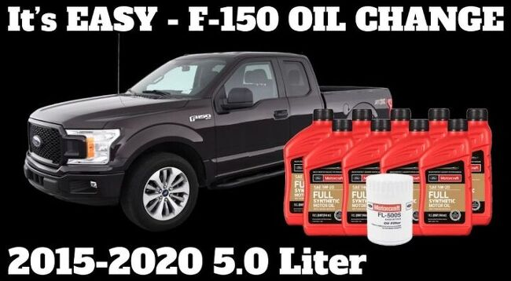

## The Story

If you own a 2015 - 2020 5.0 Liter Ford F150 and you are tired of paying the dealership for oil changes here are the step-by-step instructions to do it yourself.It.

Report: GM Allegedly Pumping The Breaks On Full-Size EVs
Connie Peters Drives The 2026 Ford Explorer Tremor
Chinese Vehicle Content Rules Forcing Polestar Out of U.S. Next Year
See Edits
News Blog
Ford
Maintenance
NEW!. DIY Oil Change for the 2015-2020 Ford F-150 5.0 — It’s Easy!. By
Tony&#039;s Fords and Mustangs | TTAC Creator
(IC: )
Published: November 19th, 2026
Share
If you own a 2015 - 2020 5.0 Liter Ford F150 and you are tired of paying the dealership for oil changes here are the step-by-step instructions to do it yourself. It's simple, requires very few tools, your job should be a bit cleaner, and you will be saving yourself quite a few dollars over the ownership of your truck.

Ford recommends changing the engine oil every 7,500 to 10,000 miles, but the presenter believes that interval is too long for owners planning to keep their trucks well beyond the factory warranty period.

Instead, he changes his oil approximately every 5,000 miles, arguing that contaminated oil can accelerate wear on internal engine components, including camshaft and crankshaft bearings. Although some quick-lube businesses recommend changes every 3,000 miles, he considers that unnecessarily frequent.

His goal is to maximize engine longevity through preventive maintenance rather than simply following the manufacturer's recommended schedule. The F-150 requires approximately 8.8 quarts of engine oil, making a large drain pan essential. The presenter identifies several items needed for the job:.

Ford specifies an FL500S oil filter for his truck, but the presenter uses an FL820S filter he already has available. He explains that the alternative has matching threads and gasket dimensions, along with slightly greater capacity, and confirms that it fits during installation.

The process begins by opening the hood and loosening the oil filler cap, which the presenter believes helps the old oil drain more freely. The F-150's ground clearance allows him to work underneath without raising the vehicle. He positions a large drain pan beneath the engine and removes the threaded plastic drain plug by hand.

One challenge involves the location of the front sway bar, which can interfere with the draining oil and create a mess. To minimize spills, he partially loosens the drain plug and uses it to regulate the oil flow rather than removing it immediately. This approach proves effective, allowing him to drain most of the oil in approximately five minutes without making a significant mess.

He then leaves the drain open for another 20 minutes to remove as much remaining oil as possible. The presenter also discusses the plastic drain plug and its single rubber O-ring, which prevents leaks. Ford recommends replacing the O-ring or the entire plug periodically. He plans to replace the original plug with an aftermarket aluminum version from UPR featuring two O-rings for additional protection against leaks.

The F-150's oil filter is mounted low on the engine and accessed from underneath the front of the truck. Although Ford designed a drainage spout to direct oil away from the engine during filter removal, the presenter finds it largely ineffective. Oil runs down the back of the engine instead of flowing through the intended channel, creating an unavoidable mess.

He loosens the old filter by hand, allowing the remaining oil to drain before removing it completely. The replacement FL820S filter fits despite being slightly larger than the factory-specified FL500S. He installs it by hand and cleans the surrounding area to prevent residual oil from dripping onto his driveway.

## Why It Matters

Report: GM Allegedly Pumping The Breaks On Full-Size EVs
Connie Peters Drives The 2026 Ford Explorer Tremor
Chinese Vehicle Content Rules Forcing Polestar Out of U.S.

<figure class="article-inline-img">
  
  <figcaption class="img-credit">Source: thetruthaboutcars.com (original article)</figcaption>
</figure>

## CarMotion Daily's Take

Next Year
See Edits
News Blog
Ford
Maintenance
NEW!. Watch this space over the coming weeks. Markets rarely reward single announcements — execution over the next two to four quarters is what closes the gap between press release and customer. How this lands depends less on the announcement itself and more on the rollout, dealer support, and after-sales story behind it. Specifics on pricing, availability, and regional rollout will tell us whether this moves from headline to delivery. Independent verification and follow-up coverage from rival outlets tend to firm up the picture within days.

<figure class="article-inline-img">
  
  <figcaption class="img-credit">Source: thetruthaboutcars.com (original article)</figcaption>
</figure>

---

📝 Source & Copyright Notice

  <strong>Original Source:</strong> 
  This story was first reported by <strong>TTAC</strong>.
  For the full article with original photography and complete coverage, visit the source:
  <a href="https://www.thetruthaboutcars.com/cars/news-blog/diy-oil-change-for-the-2015-2020-ford-f-150-5-0-its-easy-45137155?utm_medium=auto&utm_source=rss&utm_campaign=all_full" target="_blank" rel="noopener">Read the full story at TTAC →</a>

  ⚠️ <strong>Copyright Notice:</strong> CarMotion Daily is an automated news aggregation service.
  We publish short rewritten summaries under Fair Use principles, with links back to the original sources.
  Images are extracted directly from the original news articles via Open Graph protocol, with attribution.
  All trademarks and copyrights belong to their respective owners. For takedown requests, contact us.

