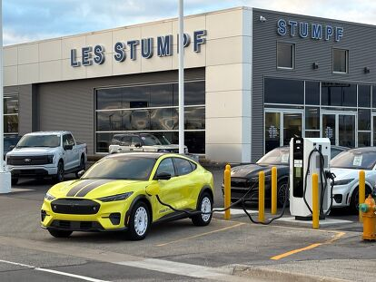
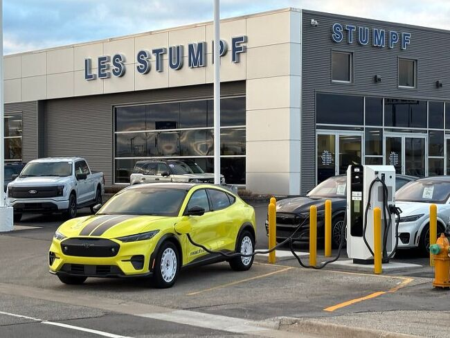

## The Story

A 29,547-driver survey finds EV owners fear misinformation more than cost or charging. Here.

Report: GM Allegedly Pumping The Breaks On Full-Size EVs
Connie Peters Drives The 2026 Ford Explorer Tremor
Chinese Vehicle Content Rules Forcing Polestar Out of U.S. Next Year
See Edits
News Blog
Electric vehicles
Tesla
649 Views
EV Owners Fear Myths More Than Cost or Charging
by
TTAC News Staff
(IC: )
Published: November 18th, 2026
Share
Ask people who already drive electric cars what stands in the way of wider adoption, and they do not point first to sticker prices or missing chargers. They point to misinformation. In the 2026 Global EV Driver Survey, 74 percent of respondents named myths as a top barrier to adoption in their own country, well ahead of the 49 percent who cited purchase price and the 47 percent who flagged charging access in apartment buildings. Respondents could pick up to three answers, so these are not mutually exclusive, but the ranking is telling.

Add TheTruthAboutCars as a Preferred Source on Google
The survey is not a small one. It collected answers from 29,547 drivers of electric cars across 34 countries. Participants signed up through EV associations and through volunteers and enthusiasts, and the worldwide results were weighted by each country's share of the EV fleet. A caveat worth keeping in mind: this is a sample of people who already own EVs, so it captures owner opinion instead of pinning down why non-owners stay away. Still, the people living with the technology have a clear read on what the rest of the world gets wrong about it.

What stands out is the gap between what owners say others believe and what owners themselves worry about. Battery lifespan tops the list of perceived myths, yet 65 percent of respondents rejected any suggestion that they feared for the lifespan of their own battery, while only 18 percent agreed. The people who have the most direct experience with these batteries are the least afraid of them.

Owners are not in denial about everything, though. They acknowledged that EVs still carry high prices and that charging is hard for anyone without somewhere to plug in at home.

This is the fear owners most often say others carry, and it is the one their own experience most directly contradicts. Batteries lose capacity gradually, and heat and hard charging speed that up. But most modern traction batteries do not become unusable after a few years, and replacing a whole pack outside of warranty defects is rare.

The claim that EVs burn more easily than conventional cars is a persistent myth, and the data does not support it. The available fire figures show gasoline vehicles catch fire at a higher rate per vehicle on the road than EVs do. Insurers reach the same conclusion. The General Association of the German Insurance Industry states that studies show no greater fire risk for electric cars than for petrol or diesel vehicles, and that vehicle insurance statistics give no indication of a higher fire risk.

The fact-checks land in the same place. No examined expert report or statistic shows a higher fire risk for EVs, and vehicle fires have decreased overall even as the proportion of electric cars has risen. The perception runs backward from the evidence.

So why the perception gap?. Two reasons. First, clips of electric cars on fire spread fast, and a high-voltage battery fire can look spectacular. Second, EV fires receive outsized media coverage relative to their actual frequency. There is a genuine operational point buried in the hype: EV battery fires are harder to extinguish and can reignite, requiring special procedures from emergency responders. That is a challenge for fire crews, not evidence that the cars burn more often.

The idea that electric vehicles disable the power grid is another persistent myth. The grounded version of the concern is real: more EVs and heat pumps push up electricity demand and require local grid upgrades, and grid operators do have to plan around peak loads.

## Why It Matters

Next Year
See Edits
News Blog
Electric vehicles
Tesla
649 Views
EV Owners Fear Myths More Than Cost or Charging
by
TTAC News Staff
(IC: )
Published: November 18th, 2026
Share
Ask people who already drive electric cars what stands in the way of wider adoption, and they do not point first to sticker prices or missing chargers.

<figure class="article-inline-img">
  
  <figcaption class="img-credit">Source: thetruthaboutcars.com (original article)</figcaption>
</figure>

## CarMotion Daily's Take

In the 2026 Global EV Driver Survey, 74 percent of respondents named myths as a top barrier to adoption in their own country, well ahead of the 49 percent who cited purchase price and the 47 percent who flagged charging access in apartment buildings. The detail bears tracking. Electric momentum is uneven across the industry, and moves like this reshape how buyers compare EV lineups. Range, charging speed, and price still dominate EV shopping — every new entry forces competitors to either match or reposition. Watch for EPA range certifications and DC fast-charge benchmarks once independent tests land. Pricing tiers, software updates, and any regional trim adjustments will tell us how serious the launch intent is.

<figure class="article-inline-img">
  
  <figcaption class="img-credit">Source: thetruthaboutcars.com (original article)</figcaption>
</figure>

---

📝 Source & Copyright Notice

  <strong>Original Source:</strong> 
  This story was first reported by <strong>TTAC</strong>.
  For the full article with original photography and complete coverage, visit the source:
  <a href="https://www.thetruthaboutcars.com/cars/news-blog/ev-owners-fear-myths-more-than-cost-or-charging-45137134?utm_medium=auto&utm_source=rss&utm_campaign=all_full" target="_blank" rel="noopener">Read the full story at TTAC →</a>

  ⚠️ <strong>Copyright Notice:</strong> CarMotion Daily is an automated news aggregation service.
  We publish short rewritten summaries under Fair Use principles, with links back to the original sources.
  Images are extracted directly from the original news articles via Open Graph protocol, with attribution.
  All trademarks and copyrights belong to their respective owners. For takedown requests, contact us.

