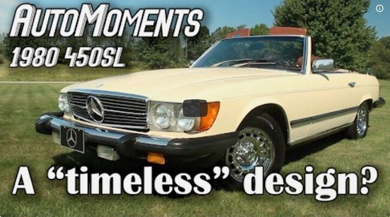
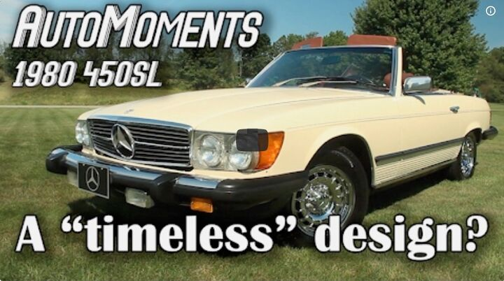

## The Story

Known as the R107, the third generation of the Mercedes-Benz SL lasted for 17 model years.In this Time Warp Test Drive, we discover the secret to the SL.

Report: GM Allegedly Pumping The Breaks On Full-Size EVs
Connie Peters Drives The 2026 Ford Explorer Tremor
Chinese Vehicle Content Rules Forcing Polestar Out of U.S. Next Year
See Edits
News Blog
Mercedes-Benz
Design
434 Views
1980 Mercedes-Benz 450SL — Is This a “Timeless” Design?. By
AutoMoments | TTAC Creator
(IC: )
Published: November 19th, 2026
Share
Known as the R107, the third generation of the Mercedes-Benz SL lasted for 17 model years. In this Time Warp Test Drive, we discover the secret to the SL's longevity while grand touring on a beautiful summer day.

Despite its relatively compact dimensions, the 450 SL feels substantial. That same emphasis on quality carries over to the interior. The seats are comfortable, visibility is excellent, and overall material quality and fit and finish are impressive for the era. Some plastics haven't aged particularly well, and the automatic climate-control system was initially plagued by reliability issues, although Mercedes eventually addressed those problems.

Nevertheless, pressing the accelerator produces respectable acceleration, and the car moves with confidence. The 1980 model was the final year for the 4.5-liter V8. For 1981, Mercedes replaced it with an aluminum 3.8-liter V8 and renamed the car the 380 SL. The newer engine also brought a four-speed automatic transmission. Unfortunately, U.S.-market SL models were never offered with a manual gearbox.

Today, the 450 SL offers a much more accessible entry into classic Mercedes-Benz ownership, with examples potentially selling for less than $20,000 and some even approaching $10,000.

## Why It Matters

Next Year
See Edits
News Blog
Mercedes-Benz
Design
434 Views
1980 Mercedes-Benz 450SL — Is This a “Timeless” Design?.

<figure class="article-inline-img">
  
  <figcaption class="img-credit">Source: thetruthaboutcars.com (original article)</figcaption>
</figure>

## CarMotion Daily's Take

Markets rarely reward single announcements — execution over the next two to four quarters is what closes the gap between press release and customer. How this lands depends less on the announcement itself and more on the rollout, dealer support, and after-sales story behind it. Specifics on pricing, availability, and regional rollout will tell us whether this moves from headline to delivery. Independent verification and follow-up coverage from rival outlets tend to firm up the picture within days.

<figure class="article-inline-img">
  
  <figcaption class="img-credit">Source: thetruthaboutcars.com (original article)</figcaption>
</figure>

---

📝 Source & Copyright Notice

  <strong>Original Source:</strong> 
  This story was first reported by <strong>TTAC</strong>.
  For the full article with original photography and complete coverage, visit the source:
  <a href="https://www.thetruthaboutcars.com/cars/news-blog/1980-mercedes-benz-450sl-is-this-a-timeless-design-45137152?utm_medium=auto&utm_source=rss&utm_campaign=all_full" target="_blank" rel="noopener">Read the full story at TTAC →</a>

  ⚠️ <strong>Copyright Notice:</strong> CarMotion Daily is an automated news aggregation service.
  We publish short rewritten summaries under Fair Use principles, with links back to the original sources.
  Images are extracted directly from the original news articles via Open Graph protocol, with attribution.
  All trademarks and copyrights belong to their respective owners. For takedown requests, contact us.

