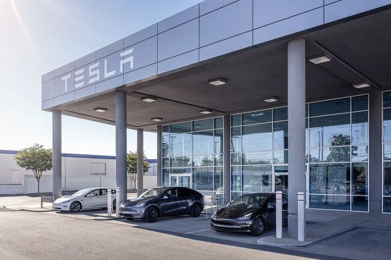

## The Story

Used EV sales climbed 73% year-over-year in October, Tesla slipped in the rankings, and average asking prices dipped to $36,582.

Report: GM Allegedly Pumping The Breaks On Full-Size EVs
Connie Peters Drives The 2026 Ford Explorer Tremor
Chinese Vehicle Content Rules Forcing Polestar Out of U.S. Next Year
See Edits
News Blog
Electric vehicles
Used Cars
NEW!. Used EV Sales Climbed 73 Percent in October, Teslas Slipped
by
TTAC News Staff
(IC: )
Published: November 19th, 2026
Share
Americans picked up roughly 48,678 used EVs in October, a 4.7 percent rise over September and 73.2 percent higher than a year earlier, according to the latest EV Market Monitor from Cox Automotive. Tesla still led the pack. It just led a little less.

Enjoy our posts?. Add TheTruthAboutCars as a Preferred Source on Google
Per Cox Automotive, used Tesla sales dropped 5.4 percent from September, as the Model 3, Model Y, and Model X each lost ground. That slip cost the brand a rung in the rankings, Cox says, with Chevrolet jumping past Ford into second. Hyundai and BMW filled out the rest of the top five.

That 73 percent year-over-year jump needs context. The federal EV tax credit had just expired, making October 2025 the first full month without it, and used EV purchases that month ran around 30,000, per Cox Automotive. EVs accounted for 3.3 percent of U.S. Used car sales in October, Cox says, matching the record set in September and climbing from 2 percent the year before.

For shoppers, the average used EV asking price was $36,582, which Cox pegs as a drop from the $36,767 recorded in September and 1.9 percent under the figure from a year earlier. The Equinox EV, ID.4, Mach-E, and Nissan Ariya all got cheaper, per Cox. Used Teslas did not, rising 1.8 percent for a second consecutive month to an average of $34,109, still about $2,500 below the overall average.

At October's pace, Cox says dealers were sitting on 38 days of used EV supply, versus 47 for gas cars and hybrids. Used Teslas moved fastest of any major brand Cox tracked, at 32 days, though that count excludes Tesla's own stores. New EV sales, meanwhile, hit 83,262, with the Model Y accounting for nearly 44 percent of them, according to Cox.

Lou--There is more competition in the EV market Tesla no longer has a lock on the EV market. As for the Cybercab very limited demand especially now with the operation of the Cybercab being limited to a handful of states. Musk is now trying to walk back his support of MAGA and Trump after the Blue Tsunami but too soon after he spent a half a million on Trump endorsed MAGA candidates that lost. People don't forget that quickly. See a number of new Kia and Hyundai EVs in Southern Arizona where in the past more Teslas. Globally the Chinese are dominating the EV market with BYD being the largest and fastest growing, taking market share away from Tesla. With all the recent issues with the FAA, the banks, Microsoft, and utility companies being hacked it does not inspire a lot of confidence in self-driving cars. What is to prevent Tesla or Waymo self-driving cabs from being hacked?.

Lou, are you saying that people in the used car market are moving on to newer used products that weren't available as used products before they were introduced as new vehicles?. That's wild.

So per the article the prices of used Teslas did not fall like other used EV's and the sit on the lot the least amount of time of any EV. This seems more like a function of more EV's becoming available and the pie being sliced a little differently as a result than some sort of collapse in demand like the 2 of you root for.

Jeffs, this is an article about the used EV market. Why did you talk about the Cybercab, Make America Great Again, President Trump, the election and then immediately pivot into Kias and Hyundais in Arizona, and then talk about how bank computer systems and Microsoft are somehow involved in Waymos.

## Why It Matters

Lou--There is more competition in the EV market Tesla no longer has a lock on the EV market.

<figure class="article-inline-img">
  
  <figcaption class="img-credit">Source: thetruthaboutcars.com (original article)</figcaption>
</figure>

## CarMotion Daily's Take

Next Year
See Edits
News Blog
Electric vehicles
Used Cars
NEW!. Watch this space over the coming weeks. Electric momentum is uneven across the industry, and moves like this reshape how buyers compare EV lineups. Range, charging speed, and price still dominate EV shopping — every new entry forces competitors to either match or reposition. Watch for EPA range certifications and DC fast-charge benchmarks once independent tests land. Pricing tiers, software updates, and any regional trim adjustments will tell us how serious the launch intent is.

<figure class="article-inline-img">
  
  <figcaption class="img-credit">Source: thetruthaboutcars.com (original article)</figcaption>
</figure>

---

📝 Source & Copyright Notice

  <strong>Original Source:</strong> 
  This story was first reported by <strong>TTAC</strong>.
  For the full article with original photography and complete coverage, visit the source:
  <a href="https://www.thetruthaboutcars.com/cars/news-blog/used-ev-sales-climbed-73-percent-in-october-teslas-slipped-45137149?utm_medium=auto&utm_source=rss&utm_campaign=all_full" target="_blank" rel="noopener">Read the full story at TTAC →</a>

  ⚠️ <strong>Copyright Notice:</strong> CarMotion Daily is an automated news aggregation service.
  We publish short rewritten summaries under Fair Use principles, with links back to the original sources.
  Images are extracted directly from the original news articles via Open Graph protocol, with attribution.
  All trademarks and copyrights belong to their respective owners. For takedown requests, contact us.

