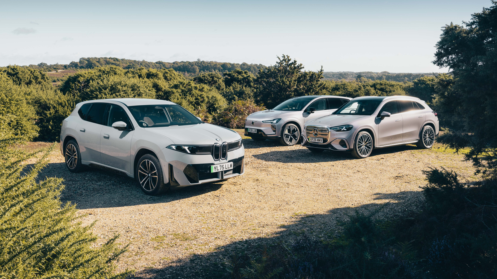
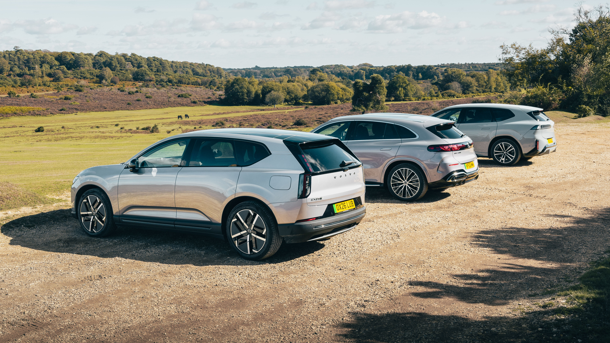

## The Story

We pit our long-term BMW against its rivals. The results are what you&#x27;d expect from three heavy e-SUVs.

Except… BMW, Mercedes and Volvo have all launched their posh new electric SUVs inside a few months, which means we can do this test and then you’ll be safe in your decision until the next lease runs out. Hurrah for stability.

First, some numbers. The iX3 – currently halfway through its time on TG’s Garage fleet – is here in 50 form, which means twin electric motors, 4WD and 463bhp. A whopper of a 108.7kWh battery (usable, and how we’ll state all from here on) is rated at 497 miles. This one is £61,255 in M Sport guise (the middle of three trims) and as tested it’s £65,805. A 40 version has also just gone on sale, with one rear motor, plus an 82.6kWh battery for 395 miles of range.

But, but, but, climb inside and it does feel special. The Merc’s tan leather is more appealing than the blackhole BMW, more practical than the kids-please-do-not-touch white leather of the Volvo. And, with the show-stopping 39.1in Hyperscreen, high-set dash that wraps around with ample ambient lighting, lashings of chrome and wood, and a pan roof that floods the cabin with light, it has showroom sparkle.

It’s the most straightforward to use, too. The pop-out door handles are spring-loaded, which is hardly innovative but make the inert handles in the BMW feel (even more) uninviting. The controls on the steering wheel are clear, ditto the column stalks for the wipers and gearbox, and it’s so normal I initially don’t find the interior door handle because it’s right where you’d expect. How quaint.

After the razzmatazz of the Merc, the Volvo is all Scandi sensibility. The exterior looks like the future (if the Merc is the present, and the BMW is the future gone wrong) and I’m not offended by the little fins that are the door handles either.

## Why It Matters

Which is in part because of the black leather, in part because we picked an iX3 to run without the pricey panoramic roof.

<figure class="article-inline-img">
  
  <figcaption class="img-credit">Source: topgear.com (original article)</figcaption>
</figure>

## CarMotion Daily's Take

Except… BMW, Mercedes and Volvo have all launched their posh new electric SUVs inside a few months, which means we can do this test and then you’ll be safe in your decision until the next lease runs out. Watch this space over the coming weeks. Electric momentum is uneven across the industry, and moves like this reshape how buyers compare EV lineups. Range, charging speed, and price still dominate EV shopping — every new entry forces competitors to either match or reposition. Watch for EPA range certifications and DC fast-charge benchmarks once independent tests land. Pricing tiers, software updates, and any regional trim adjustments will tell us how serious the launch intent is.

<figure class="article-inline-img">
  
  <figcaption class="img-credit">Source: topgear.com (original article)</figcaption>
</figure>

---

📝 Source & Copyright Notice

  <strong>Original Source:</strong> 
  This story was first reported by <strong>TopGear</strong>.
  For the full article with original photography and complete coverage, visit the source:
  <a href="https://news.google.com/rss/articles/CBMiqgFBVV95cUxPWW96Q19LVkR5LXA3aHR2elZkRUVqaHdGc19kMHBtNno0dmVzR1lERndtU0hETmRua0J5QVN2QTF5c0VGUFFEOTIyYmRCVGpDcnJIaXhZV2pvX09mRnMtWmpPYjFvQmxPcV9XM1Z1VlNabWVjNEROeUFIQWJCcjViYTdOa2RvT1FYSkxvVjdNa1ppOUY3bkt2ejhWSVk2LVkzMFk4YldXODltdw?oc=5" target="_blank" rel="noopener">Read the full story at TopGear →</a>

  ⚠️ <strong>Copyright Notice:</strong> CarMotion Daily is an automated news aggregation service.
  We publish short rewritten summaries under Fair Use principles, with links back to the original sources.
  Images are extracted directly from the original news articles via Open Graph protocol, with attribution.
  All trademarks and copyrights belong to their respective owners. For takedown requests, contact us.

