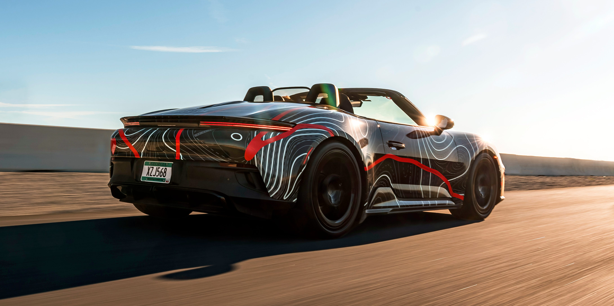

## The Story

The Boxster’s rear-biased weight distribution, which is unusual for an EV, makes it handle like a sports car should.

View PhotosPorscheThere’s still a lot that Porsche won’t divulge about its forthcoming 2028 718 Boxster EV, including horsepower, battery capacity, range, pricing, or even its final, un-camouflaged looks. But after some seat time around the handling course at the Porsche Experience Center Los Angeles, we now know what it feels like at—and a little bit beyond—its cornering limits.

Whether you’re welcoming the Boxster’s EV transition or bemoaning the loss of its internal-combustion engines, particularly the iconic flat-six, we think anyone who drives the next-generation 983 Boxster will agree it’s fantastic. The steering, inherited from the 992.2 911 Carrera GTS, is eager and sharp, and rear-axle steering will also be available. You can feel the Boxster’s rear-biased weight distribution in the way its rear end steps out when lifting off the throttle.

In other words, this new EV feels like a mid-engine Boxster, because that’s where the weight is concentrated. Other than some hypercars, such as the Rimac Nevera, the forthcoming electric Boxster rides atop one of the first EV platforms built around a two-seat sports car. The 800-volt battery pack lives entirely behind the passenger cabin, in the place the engine used to reside, which leads to a 40/60 front/rear weight distribution, similar to the gas-powered Boxster’s 45/55 split. And since there’s no battery under the floor, you sit as low as you would in any other sports car.

We drove what will become the top Boxster model when it goes on sale after its formal debut in early 2027, but Porsche wouldn’t confirm what it will be called. S?. GTS?. These models wear Pirelli P Zero R Elect tires—and for the first time—mount on staggered-diameter wheels just like the latest 911. The tires measure 255/35ZR-20 up front and 305/30ZR-21 in back, which is more meat than even the last 718 Spyder RS. The company isn’t saying how much power this Boxster’s single rear motor will make—all electric Boxsters will be rear-drive only—but they do claim the sprint to 60 mph will require less than 3.0 seconds. After experiencing being pinned to the seat by a few launch-control starts, the new Boxster feels every bit that quick.

Porsche says this will be the quickest, most powerful Boxster with the highest cornering and braking performance, with a center of gravity that’s—no surprise—much lower than before. We can attest to feeling tons of grip, but can we feel the EV’s added weight?. As the Boxster slithered through transitions and dove into apexes, we can’t say it felt heavy, although the squealing from its wide tires sounded at times more tortured than those we recall from the just-over-3000-pound gas-powered Boxster. Porsche says the Boxster EV’s curb weight will fall somewhere within that of the 911 lineup, which ranges from the 3350-pound Carrera to the 4000-pound Turbo S Cabriolet. Here’s hoping it’s toward the lower end of that range, which would be very light for an EV.

While this new electric version looks like a Boxster and the low seating position feels like a Boxster, with a forward view of a quickly disappearing hood, Porsche wanted to add some more nostalgic tie-ins by way of fabricated engine noises and simulated shifts. The Taycan got a similar E-Shift feature earlier this year, but while the Taycan’s engine noises weren’t modeled after a specific engine, the Boxster’s very much pays homage to its past. The Boxster’s E-Shift, which is controlled by a knob on the steering wheel and can shift automatically or be controlled by steering wheel paddles, mimics the 981 Boxster GTS’s 3.4-liter flat-six, which Porsche engineers say is the high-water mark for flat-six wails. They told us emissions compromises to the most recent flat-sixes made them choose that one from circa 2015. That said, there’s a bit of revisionist history going on with the electric Boxster’s 8000-rpm “redline” versus the actual 7600-rpm redline in its 981 muse. Either way, the noise emanating from the two speakers—one inside the cabin, one outside—absolutely sounds like a flat-six.

Although the synthesized sound is a solid re-creation, we do think it would be easy to identify the real from the facsimile in a blindfolded test. There’s a lot of nuance going on in the sounds of a flat-six belting to redline—intake and exhaust noise, valve and other mechanical clatter—and it’s hard to generate all of that from a couple speakers. That said, after doing a few hot laps with the system on, we believe it adds to the experience, and it felt weird to switch over to silent and shift-free lapping. We think we’d use this more in a sports car like the Boxster than in the four-door Taycan sedan.

What else did we learn?. As before, the 983 Boxster has both front and rear trunks, and its NACS charge port, which is hidden behind a powered door in the middle of the rear bumper, is the first from Porsche to accommodate both AC and DC charging. Today’s Cayenne and Taycan electrics have separate ports for AC and DC with the NACS only handling DC charging.

Officially, there won’t be any gas-powered Boxster variants, but who knows what the lifecycle might hold, especially if early sales disappoint. After all, remember when the previous generation went four-cylinder only, but then the flat-six made a reappearance a few years later?. While we’re as sad as anyone to see the flat-six and manual transmission leave the Boxster lineup, we think that anyone who drives the new one will agree it’s a great-handling sports car.

Dave VanderWerp has spent more than 20 years in the automotive industry, in varied roles from engineering to product consulting, and now leading Car and Driver's vehicle-testing efforts. Dave got his very lucky start at C/D by happening to submit an unsolicited resume at just the right time to land a part-time road warrior job when he was a student at the University of Michigan, where he immediately became enthralled with the world of automotive journalism.

## Why It Matters

While this new electric version looks like a Boxster and the low seating position feels like a Boxster, with a forward view of a quickly disappearing hood, **Porsche** wanted to add some more nostalgic tie-ins by way of fabricated engine noises and simulated shifts.

<figure class="article-inline-img">
  
  <figcaption class="img-credit">Source: caranddriver.com (original article)</figcaption>
</figure>

## CarMotion Daily's Take

Other than some hypercars, such as the Rimac Nevera, the forthcoming electric Boxster rides atop one of the first EV platforms built around a two-seat sports car. Watch this space over the coming weeks. Electric momentum is uneven across the industry, and moves like this reshape how buyers compare EV lineups. Range, charging speed, and price still dominate EV shopping — every new entry forces competitors to either match or reposition. Watch for EPA range certifications and DC fast-charge benchmarks once independent tests land. Pricing tiers, software updates, and any regional trim adjustments will tell us how serious the launch intent is.

---

📝 Source & Copyright Notice

  <strong>Original Source:</strong> 
  This story was first reported by <strong>CarAndDriver</strong>.
  For the full article with original photography and complete coverage, visit the source:
  <a href="https://www.caranddriver.com/reviews/a74493752/2028-porsche-718-boxster-ev-prototype-drive/" target="_blank" rel="noopener">Read the full story at CarAndDriver →</a>

  ⚠️ <strong>Copyright Notice:</strong> CarMotion Daily is an automated news aggregation service.
  We publish short rewritten summaries under Fair Use principles, with links back to the original sources.
  Images are extracted directly from the original news articles via Open Graph protocol, with attribution.
  All trademarks and copyrights belong to their respective owners. For takedown requests, contact us.

