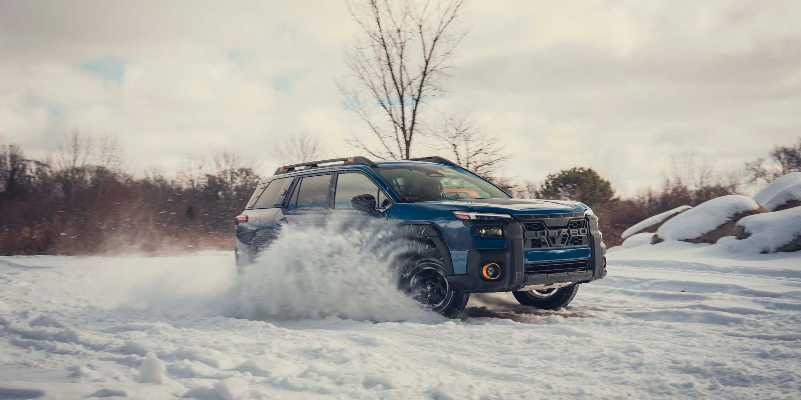

## The Story

Snow performance is all about tires and clearance, so we selected the top-rated new vehicles that come from the factory with snow-rated rubber.

Marc Urbano|Car and DriverWhen discussing a car’s performance in the snow, it all comes down to tires and clearance. Tires are the only part of your vehicle that makes contact with the road, so the rubber mounted on your car is the number-one determiner of how much grip you’ll have while accelerating, turning, or braking on slippery surfaces such as snow and ice. All-wheel drive may help you get going in the snow, but it doesn’t help you stop.

So, when selecting this list of best vehicles for snow, we included only top-rated models that come standard from the factory with tires rated for severe snow service. These tires are marked with the all-important three-peak mountain snowflake icon (3PMSF). This icon is found on either all-weather tires or all-terrain tires that have been tested and are capable of at least 110 percent of the traction of a reference all-season tire. Not every all-terrain tire carries this marking.

It’s also important to mention that any car with winter tires would be our preferred method of transportation in snowy conditions. If you don’t want to pony up for one of these SUVs or trucks with their often pricey optional off-road packages that include the 3PMSF tires, consider outfitting a different vehicle with winter tires. Check out our Winter Tire Buying Guide for advice on which tires to choose.

The CX-50 is one of our favorite compact SUVs, and it offers a rugged-looking trim level called the Meridian Edition. This version comes with snow-rated all-terrain tires no matter whether you choose the naturally aspirated 2.5 S Meridian Edition or the more powerful Turbo Meridian Edition.

Subaru has offered standard all-wheel drive on nearly all of its models for quite a while now, which has earned it a reputation for all-weather performance. But not every Subaru comes with tires optimized for snow. Only the Wilderness version of the Outback mid-size SUV comes with Yokohama Geolandar All-Terrain tires that carry this rating. (The Forester Wilderness and Crosstrek Wilderness also have these tires, but those models don’t rate as high in our testing.).

The GX is closely related to the Toyota Land Cruiser and is the most off-road-ready SUV in the Lexus lineup. To get snow-rated tires from the factory, you have to opt for the Overtrail model, which comes with all-terrain tires and other upgrades meant to improve the GX’s performance in the dirt and other types of off-road terrain. It has an impressive 9.8 inches of ground clearance.

No, you probably don’t need a G-wagen to traipse through a few inches of snow to get to the grocery store. But this highly capable SUV has become a style icon for its distinctive aesthetic, and for good reason. The most capable version of the G-class is the G550 with the G Professional package, which adds all-terrain tires, a roof rack, a bull bar on the front, and other off-road upgrades.

The Mustang Mach-E compact electric SUV is one of the few vehicles you can get from the factory with all-weather tires, in this case the Michelin CrossClimate2. These snow-rated tires come on certain versions of the Mach-E, including the high-performance, 480-hp Rally and the new-for-2027 Trail (pictured), which also has extra ground clearance.

If you’re not willing to go all out for the Raptor version of the F-150, this popular pickup truck also offers a lesser off-road trim level that also comes with snow-rated tires. The F-150 Tremor doesn’t have the upgraded engine or suspension from the Raptor, but it does have style upgrades and other modifications compared with the standard F-150. There are two factory tire choices, either General or Pirelli, but both have the 3PMSF icon.

Many versions of the Ram 1500 pickup offer an Off-Road Group option package that includes Falken Wildpeak all-terrain tires in various sizes, all of which have the 3PMSF icon. Ironically enough, the Ram’s most off-road-oriented versions—the Rebel, RHO, and TRX—also have all-terrain tires, but not ones specifically rated for snow.

Despite being raised on a steady diet of base-model Hondas and Toyotas—or perhaps because of it—Joey Capparella cultivated an obsession for the automotive industry throughout his childhood in Nashville, Tennessee. He found a way to write about cars for the school newspaper during his college years at Rice University, which eventually led him to move to Ann Arbor, Michigan, for his first professional auto-writing gig at Automobile Magazine. He has been part of the Hearst Autos team since 2016 and now lives in New York City.

## Why It Matters

Despite being raised on a steady diet of base-model Hondas and Toyotas—or perhaps because of it—Joey Capparella cultivated an obsession for the automotive industry throughout his childhood in Nashville, Tennessee.

<figure class="article-inline-img">
  
  <figcaption class="img-credit">Source: caranddriver.com (original article)</figcaption>
</figure>

## CarMotion Daily's Take

So, when selecting this list of best vehicles for snow, we included only top-rated models that come standard from the factory with tires rated for severe snow service. The detail bears tracking. Supply chains, regulations, and consumer demand are reshaping the playbook faster than five-year plans can keep up. Dealer networks and service capacity will need to evolve alongside whatever the headline announcement implies. Regulatory filings, supplier contracts, and any production-volume adjustments usually trail the headline by a quarter or two. Stock price moves and dealer council chatter are leading indicators worth monitoring.

---

📝 Source & Copyright Notice

  <strong>Original Source:</strong> 
  This story was first reported by <strong>CarAndDriver</strong>.
  For the full article with original photography and complete coverage, visit the source:
  <a href="https://www.caranddriver.com/features/a74466080/best-cars-for-snow/" target="_blank" rel="noopener">Read the full story at CarAndDriver →</a>

  ⚠️ <strong>Copyright Notice:</strong> CarMotion Daily is an automated news aggregation service.
  We publish short rewritten summaries under Fair Use principles, with links back to the original sources.
  Images are extracted directly from the original news articles via Open Graph protocol, with attribution.
  All trademarks and copyrights belong to their respective owners. For takedown requests, contact us.

