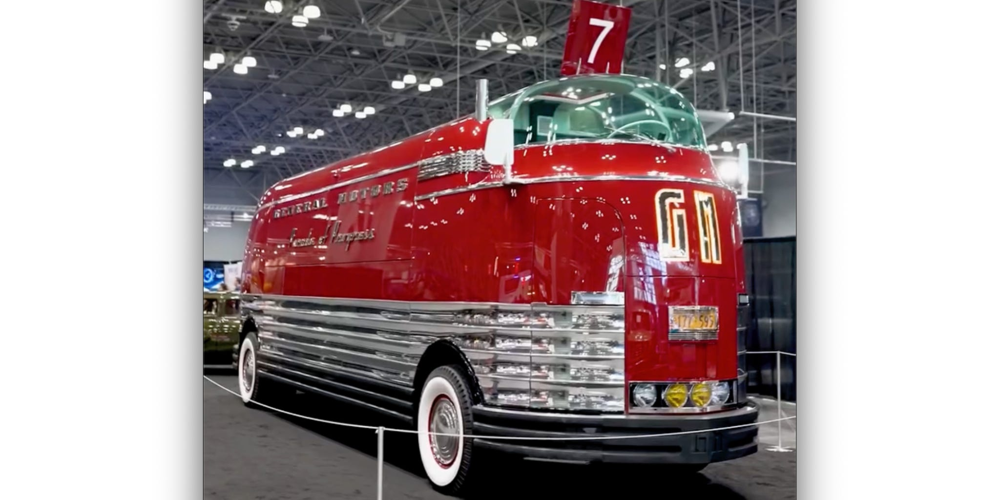

## The Story

After its starring role at the 2026 Retromobile New York show, Matt Katz and Rob Ida have big road trip plans for the 1939 Futureliner.

GMIn 1941, General Motors hit the open road with its fleet of Futureliners on the Parade of Progress, a movement meant to spread cutting-edge science and technology across America. With their bubble-top cockpits, exhibition-style innards, and shining chrome panels, the Futureliners became as much of a spectacle as the displays on automotive technology, urban engineering, farming, and leisure pursuits carried within. Now, 85 years later, a resurrected Futureliner is carrying the Parade of Progress torch into the 21st Century—starting in New York City.

Like many modern automotive stories, this Futureliner's resurrection began on Facebook Marketplace. When Matt Katz, owner of the Caretakers Collection, was sent a link to an available Futureliner on the online classified site, he jumped into action. Katz was on the phone with the seller in a matter of minutes, and quickly deputized friend and New Jersey car builder Rob Ida to travel up to Massachusetts the following day.

“[The seller] was totally caught off guard that I just called him. He's like, ‘Listen, like it's Monday night. I'm out at an event. You know, call me tomorrow.’ I'm like, ‘No, no, no, I want to make this deal now.’ I just wanted to lock it up,” Katz said to Road &amp; Track. He said he informed the seller that he wanted Ida, with whom Katz had done prior restoration projects, to come check out the Futureliner. “I was like, ‘Let me call [Ida] and get him to come out and inspect it within forty-eight hours. And if all is good, I'll wire you the balance. And if all is not, return the money to me, the deposit, and we'll call it even.’”.

Ida reported back that the Futureliner example was ripe for restoration, but the journey couldn’t begin immediately. First, Ida had to cut a larger opening in his garage to fit the Futureliner through. Standing 11-feet-7-inches tall and 33 feet long, the GM Futureliner is taller than your average school bus, and about as long as an average fire truck. But once the Futureliner had been transported and maneuvered into Ida’s garage, the real work began.

As it had been owned and restored by the Peter Pan Bus Company in the 1990s, this Futureliner build started out in better shape than most. It had been updated with GM’s post-World War II styling from 1953—a flatter and less regal version of the shape introduced in 1939. Ida and Katz wanted to bring this Futureliner back to its original Harley Earl-designed glory, but there wasn’t an official blueprint to guide them. Ida even reached out to the General Motors Heritage Center, but it had limited information available about the first-generation Futureliner design. So, Ida had to fabricate many of the parts himself. Some era-specific parts even required the creation of bespoke molds, as no replacements were available.

“We work off imagery, and we work off of any kind of text or information that we can find. Unfortunately, the Thirty-Nine version is much more difficult to find than the Fifty-Three version. Anytime you do a quick search, you're going to find all the white roof Fifty-Three generation-two post-war Futureliner. So that was really the difficult part: digging deep enough to find the Thirty-Nine version,” Ida said to Road &amp; Track.

“Somewhere in a conversation with Rob, it came to be that we both agreed: let's go back to the bubble. Let's bring it back to Thirty-Nine, and we didn't realize and truly fully appreciate what that meant. Getting the bubble done was just difficult, but we knew what to do, and Rob had experience,” Katz said. “We didn't realize that after we made that decision, everything else would change on the bus. Not just the paint colors, but also the cladding on the side. So, Fifty-Three has seven clads; ours is four. The GM logo on the front. Rob randomly found this old video by a production company called Rose that I discovered, and he poured through it and discovered in a small clip that the GM logo was backlit.”.

Once the restoration was complete, Katz and Ida were eager to show off the piece of moving history, and the inaugural Retromobile event in New York City was the perfect venue. But the newly revived Futureliner had to make it from Old Bridge, New Jersey, to Manhattan’s Jacob K. Javits Convention Center. There is no shortage of driving obstacles between those two points on a good day in a regular car, so piloting the massive machine was sure to be a challenge—but with Ida and Katz at the helm, however, the journey went smoother than expected. Thanks to dually-style front wheels, power steering, 360-degree cameras, and working air conditioning, driving the Futureliner was an exercise in patience more than anything else.

“So I drove from Columbus Circle to Times Square to Javits. And as a New Yorker, driving it in New York and just seeing people's reactions . You know, part of the enjoyment is how people react to it. I've never had a reaction like when I was driving it. And then the fact that they closed Times Square for me while we were driving, and for Rob and me . I couldn't even have fathomed that as a dream,” Katz said.

And the Futureliner’s adventures are far from over. Katz and Ida are currently scheming a cross-country road trip, starting on the East Coast in 2027 and heading west toward GM’s Heritage Center in Sterling, Michigan. After that, the Futureliner will head to California for the 2027 Pebble Beach Concours d’Elegance, with stops at dealerships and historical markers along the way. The Futureliner will then spend some time at the Petersen Automotive Museum in Los Angeles and stick around for the 2028 Summer Olympics before heading back to GM’s Heritage Center. This cross-country journey will be focused on charity efforts for organizations like the Sloan Kettering Institute for Cancer Research, which the original Parade of Progress highlighted. Trust us: if the Futureliner comes to your town, it’s worth seeing in person.

A New York transplant hailing from the Pacific Northwest, Emmet White has a passion for anything that goes: cars, bicycles, planes, and motorcycles. After learning to ride at 17, Emmet worked in the motorcycle industry before joining Autoweek in 2022 and Road &amp; Track in 2024. The woes of alternate side parking have kept his fleet moderate, with a 2014 Volkswagen Jetta GLI and a BMW 318i E30 street parked in his Queens community.

## Why It Matters

After that, the Futureliner will head to California for the 2027 Pebble Beach Concours d’Elegance, with stops at dealerships and historical markers along the way.

<figure class="article-inline-img">
  
  <figcaption class="img-credit">Source: roadandtrack.com (original article)</figcaption>
</figure>

## CarMotion Daily's Take

Now, 85 years later, a resurrected Futureliner is carrying the Parade of Progress torch into the 21st Century—starting in New York City. Watch this space over the coming weeks. Supply chains, regulations, and consumer demand are reshaping the playbook faster than five-year plans can keep up. Dealer networks and service capacity will need to evolve alongside whatever the headline announcement implies. Regulatory filings, supplier contracts, and any production-volume adjustments usually trail the headline by a quarter or two. Stock price moves and dealer council chatter are leading indicators worth monitoring.

---

📝 Source & Copyright Notice

  <strong>Original Source:</strong> 
  This story was first reported by <strong>RoadandTrack</strong>.
  For the full article with original photography and complete coverage, visit the source:
  <a href="https://www.roadandtrack.com/news/a74530928/general-motors-futureliner-restoration/" target="_blank" rel="noopener">Read the full story at RoadandTrack →</a>

  ⚠️ <strong>Copyright Notice:</strong> CarMotion Daily is an automated news aggregation service.
  We publish short rewritten summaries under Fair Use principles, with links back to the original sources.
  Images are extracted directly from the original news articles via Open Graph protocol, with attribution.
  All trademarks and copyrights belong to their respective owners. For takedown requests, contact us.

