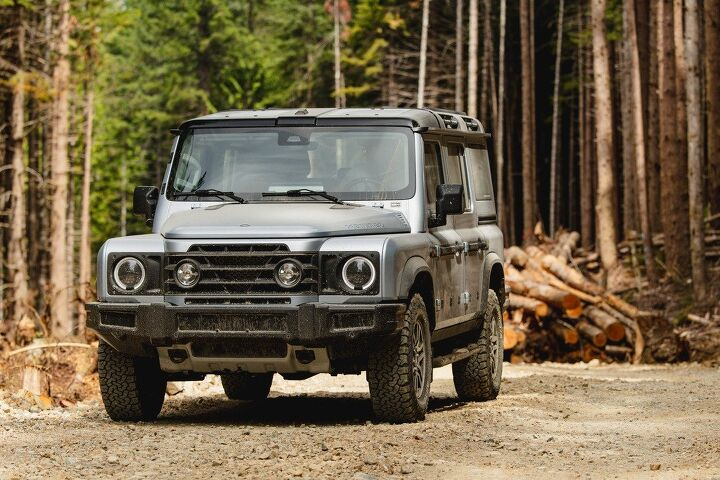

## The Story

Ineos has expressed its intention of building the Grenadier SUV and Quartermaster pickup variant within the United States as soon as possible. However, this has required that the automaker sell off its main production facility in France.   On the surface, this announcement seems like a good deal for the brand. Ineos has been building the Grenadier to effectively cater to the kind of people who want mechanically simple vehicles with serious off-road potential and traditional controls.

Report: GM Allegedly Pumping The Breaks On Full-Size EVs
Connie Peters Drives The 2026 Ford Explorer Tremor
Chinese Vehicle Content Rules Forcing Polestar Out of U.S. Next Year
See Edits
News Blog
SUVs
Travel
505 Views
Ineos Moving Production to America, Sells French Factory to China's BYD
by
Matt Posky
(IC: employee)
Published: November 25th, 2026
Share
Enjoy our posts?. Add TheTruthAboutCars as a Preferred Source on Google.

Ineos has expressed its intention of building the Grenadier SUV and Quartermaster pickup variant within the United States as soon as possible. However, this has required that the automaker sell off its main production facility in France.

On the surface, this announcement seems like a good deal for the brand. Ineos has been building the Grenadier to effectively cater to the kind of people who want mechanically simple vehicles with serious off-road potential and traditional controls. The model is basically an homage to the classic Land Rover Defender that was built from 1990-2016, as well as the Land Rover 90 and 110 models that preceded it.

It fills a similar niche as the Toyota Land Cruiser 70 Series, which has been in continuous production since roughly 1984. The big difference is that the Ineos Grenadier is a wholly unique model that was inspired by the beloved British SUV and is actually available on our market.

Since Ineos does a significant amount of business inside North America, it makes sense to relocate to the United States to help avoid tariffs. Some of the reasons we don’t get the Land Cruiser 70 Series is because it’s based on an older model that would likely have trouble passing the modern U.S. Safety and emissions regulations.

Ineos plans on getting around all of the above by simply building its vehicles stateside. It also doesn’t have to worry about the Grenadier or Quartermaster stealing sales from other models.

Despite promoting itself as a British company that only exists because of its affinity for iconic vehicles originating from the United Kingdom, Ineos does the brunt of its business on the other side of the Atlantic Ocean and has its main production facility based in Hambach, France.

That facility was a former Mercedes-Benz site, responsible for the Smart ForTwo, and will reportedly be sold to China’s BYD and is assumed to be repurposed to build all-electric vehicles sold on the European market.

The big question is what will happen in the interim period. Ineos needs a place to build its vehicles and is reportedly targeting U.S. Production for 2028. That almost assuredly means that it will be buying a preexisting facility that it can retool, rather than building something from the ground up. We’re assuming Ineos won’t be handing over the keys to BYD until after it has things up and running in the United States, unless it’s fine with an extended period of not selling anything.

Details on the arrangement haven’t yet been finalized. We haven’t heard anything on where Ineos wants to set up shop in the United States, nor when the Chinese brand expects to move into France. But the deal with BYD sounds like it’s been solidified and the British company has certainly already been browsing American real estate.

This is a massive undertaking for what is effectively a very small automaker. Ineos has only sold about 35,000 vehicles since commencing production three years ago. But volumes have been increasing and the brand estimates that about 70 percent of those sales went to people living in North America.

## Why It Matters

Ineos products don’t even come with an internal modem that can do more than send out an emergency signal, requiring customers to pair vehicles to their phone if they want to use the internet.

<figure class="article-inline-img">
  
  <figcaption class="img-credit">Source: thetruthaboutcars.com (original article)</figcaption>
</figure>

## CarMotion Daily's Take

Next Year
See Edits
News Blog
SUVs
Travel
505 Views
Ineos Moving Production to America, Sells French Factory to China's BYD
by
Matt Posky
(IC: employee)
Published: November 25th, 2026
Share
Enjoy our posts?. Watch this space over the coming weeks. Supply chains, regulations, and consumer demand are reshaping the playbook faster than five-year plans can keep up. Dealer networks and service capacity will need to evolve alongside whatever the headline announcement implies. Regulatory filings, supplier contracts, and any production-volume adjustments usually trail the headline by a quarter or two. Stock price moves and dealer council chatter are leading indicators worth monitoring.

<figure class="article-inline-img">
  
  <figcaption class="img-credit">Source: thetruthaboutcars.com (original article)</figcaption>
</figure>

---

📝 Source & Copyright Notice

  <strong>Original Source:</strong> 
  This story was first reported by <strong>TTAC</strong>.
  For the full article with original photography and complete coverage, visit the source:
  <a href="https://www.thetruthaboutcars.com/cars/news-blog/ineos-moves-to-america-sells-french-factory-to-china-s-byd-45137230?utm_medium=auto&utm_source=rss&utm_campaign=all_full" target="_blank" rel="noopener">Read the full story at TTAC →</a>

  ⚠️ <strong>Copyright Notice:</strong> CarMotion Daily is an automated news aggregation service.
  We publish short rewritten summaries under Fair Use principles, with links back to the original sources.
  Images are extracted directly from the original news articles via Open Graph protocol, with attribution.
  All trademarks and copyrights belong to their respective owners. For takedown requests, contact us.

